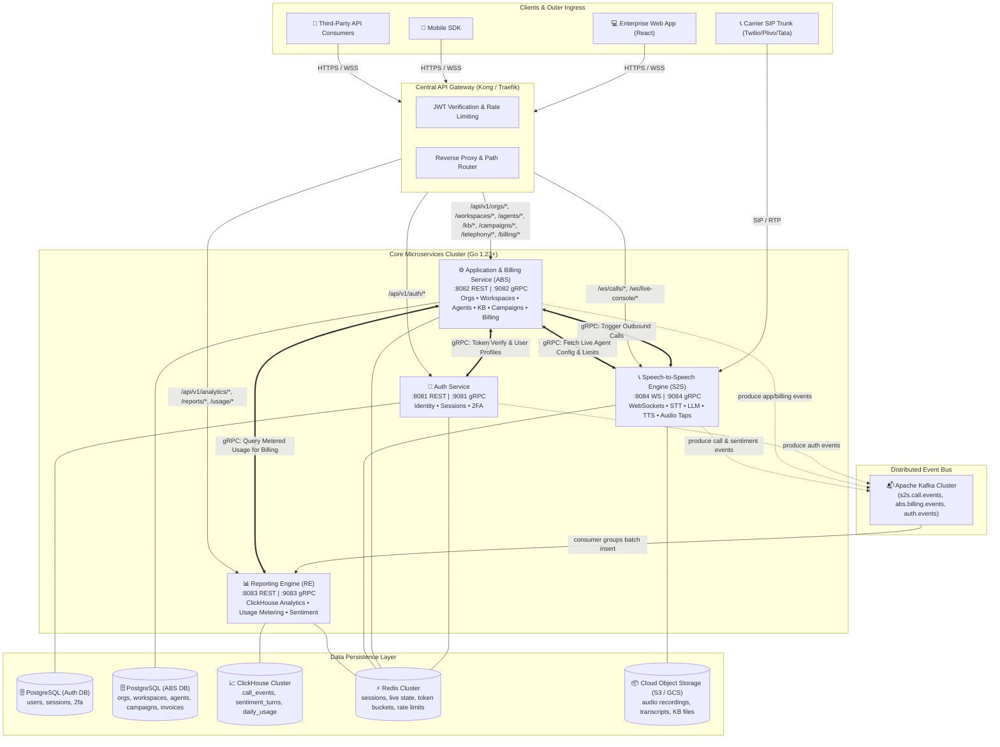
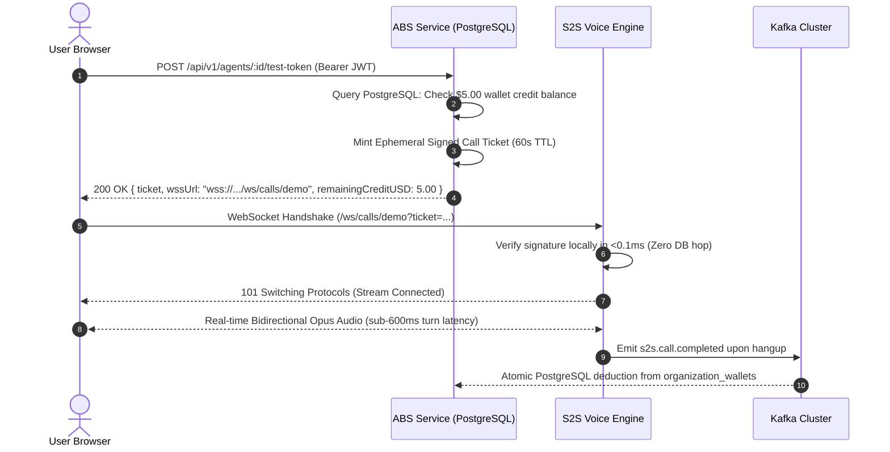
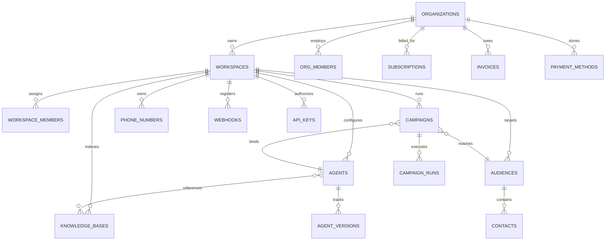
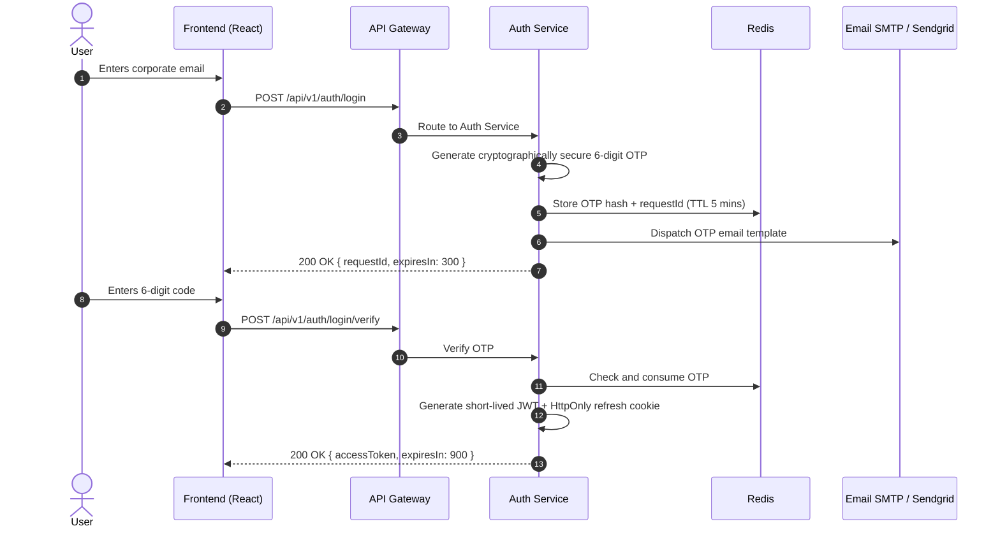
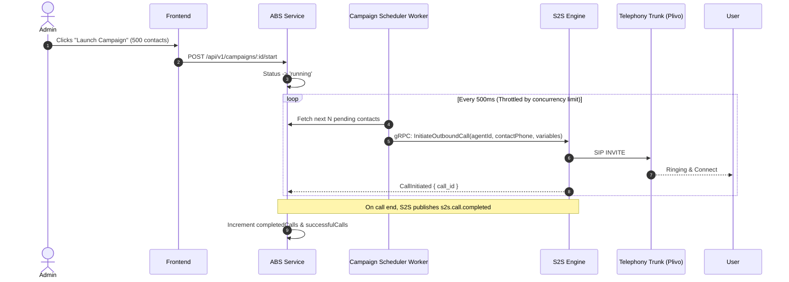
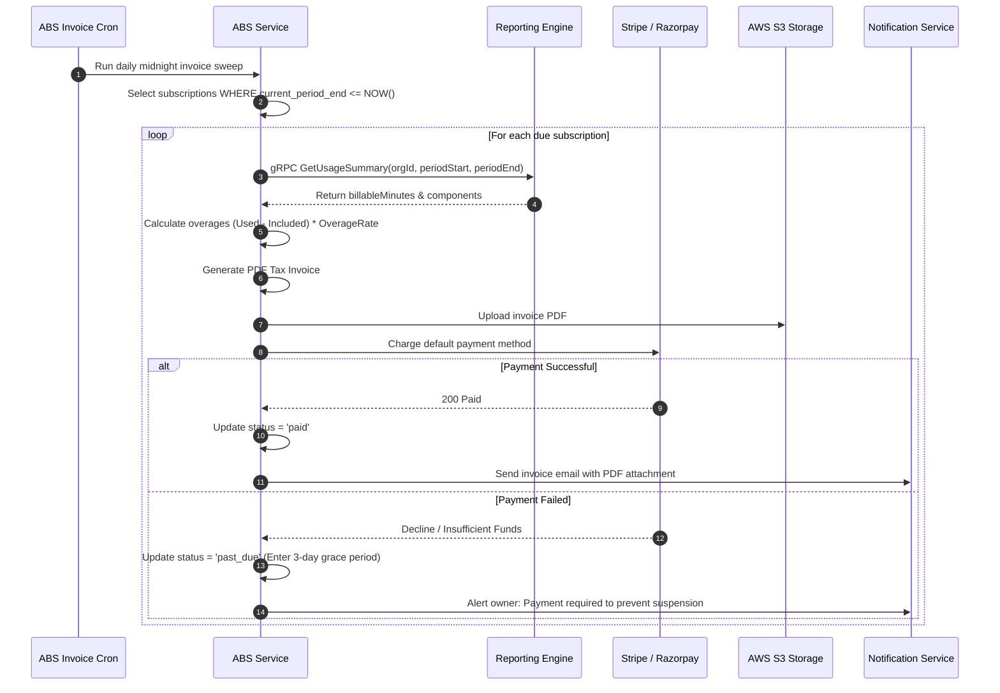

# Samvada Platform — Enterprise Backend Microservices HLD
> **High-Level Design (HLD) & Complete API Architecture Specification**  
> **Document Status:** Complete Architecture Blueprint (Production / Unicorn Scale)  
> **Date:** 2026-09-26  
> **Author:** Architecture & Core Systems Team  
> **Target Services:** Auth Service, Speech-to-Speech (S2S) Engine, Application & Billing Service (ABS), Reporting Engine (ClickHouse)

---

## Table of Contents
1. [Executive Summary & System Vision](#1-executive-summary--system-vision)
2. [Target 4-Service Architecture Overview](#2-target-4-service-architecture-overview)
   - 2.1 Topology & Service Interaction Architecture
   - 2.2 Direct S2S WebSocket vs ABS Proxy Architectural Decision (Latency, Load & Ephemeral Tickets)
3. [Service Responsibilities & Boundary Matrix](#3-service-responsibilities--boundary-matrix)
4. [ABS (Application & Billing Service) Architecture](#4-abs-application--billing-service-architecture)
   - 4.1 Clean Architecture Directory Structure
   - 4.2 Relational PostgreSQL Database Schema (DDL & ERD)
   - 4.3 Background Workers & Cron Scheduling Engines
   - 4.4 Demo Trial Credit System ($5.00 Signup Balance & PostgreSQL Wallet)
5. [Reporting Engine (ClickHouse Analytics & Usage Engine)](#5-reporting-engine-clickhouse-analytics--usage-engine)
   - 5.1 Real-Time Ingestion Architecture & Kafka Consumer Pipeline
   - 5.2 Complete ClickHouse Schema & Materialized Views
   - 5.3 Metering & Usage Calculation Algorithms
   - 5.4 Query Engine & Redis Caching
6. [Inter-Service Communication & Contracts](#6-inter-service-communication--contracts)
   - 6.1 gRPC Service Contracts (Protobuf Definitions)
   - 6.2 Kafka Event Catalog & Message Schemas
   - 6.3 Distributed Consistency & Transactional Outbox Pattern
7. [Comprehensive Categorized API Specifications & Small Flows](#7-comprehensive-categorized-api-specifications--small-flows)
   - [Category 1: Authentication & Identity APIs](#category-1-authentication--identity-apis)
   - [Category 2: Onboarding & Setup APIs](#category-2-onboarding--setup-apis)
   - [Category 3: Organization Management APIs](#category-3-organization-management-apis)
   - [Category 4: Workspace Isolation & Multi-Tenancy APIs](#category-4-workspace-isolation--multi-tenancy-apis)
   - [Category 5: Voice Agent Studio & Versioning APIs](#category-5-voice-agent-studio--versioning-apis)
   - [Category 6: Knowledge Base & RAG Document APIs](#category-6-knowledge-base--rag-document-apis)
   - [Category 7: Outbound Voice Campaign APIs](#category-7-outbound-voice-campaign-apis)
   - [Category 8: Contacts & Target Audience APIs](#category-8-contacts--target-audience-apis)
   - [Category 9: Telephony & SIP Phone Number APIs](#category-9-telephony--sip-phone-number-apis)
   - [Category 10: Live Call Console & Real-Time Operations APIs](#category-10-live-call-console--real-time-operations-apis)
   - [Category 11: Call History, Transcripts & AI Evaluation APIs](#category-11-call-history-transcripts--ai-evaluation-apis)
   - [Category 12: Reporting & Analytics Dashboard APIs](#category-12-reporting--analytics-dashboard-apis)
   - [Category 13: Billing, Plans, Invoices & Payment Gateway APIs](#category-13-billing-plans-invoices--payment-gateway-apis)
   - [Category 14: Integrations & Webhook APIs](#category-14-integrations--webhook-apis)
   - [Category 15: Developer API Key Management APIs](#category-15-developer-api-key-management-apis)
   - [Category 16: Security, 2FA & Session Management APIs](#category-16-security-2fa--session-management-apis)
   - [Category 17: Notification Preferences & Alerts APIs](#category-17-notification-preferences--alerts-apis)
   - [Category 18: User Profile & Account Settings APIs](#category-18-user-profile--account-settings-apis)
8. [Billing, Invoicing & Usage Engine Deep Dive](#8-billing-invoicing--usage-engine-deep-dive)
   - 8.1 Dual-Gateway Strategy (Stripe + Razorpay)
   - 8.2 End-of-Cycle Invoicing Flow
   - 8.3 Promotional Credits ($5.00 Trial Balance) & Wallet Lifecycle
9. [Security, Multi-Tenancy & Enterprise Isolation](#9-security-multi-tenancy--enterprise-isolation)
10. [Deployment Topology & Scale Blueprint](#10-deployment-topology--scale-blueprint)
11. [Phased Implementation Roadmap](#11-phased-implementation-roadmap)

---

## 1. Executive Summary & System Vision

Samvada is an enterprise-grade AI voice platform built for hyper-scale operations (handling tens of thousands of concurrent real-time voice calls, sub-600ms conversational turn latencies, multi-workspace enterprise isolation, automated outbound campaigns, and high-frequency real-time analytics).

To support this unicorn-scale growth without monolithic friction, the backend is split into **4 specialized microservices**:

```
                       ┌──────────────────────────────────────────────────┐
                       │                  API Gateway                     │
                       │           (Kong / Traefik / Envoy)               │
                       └───────────┬──────────────┬───────────────┬───────┘
                                   │              │               │
                     ┌─────────────▼──┐    ┌──────▼──────┐   ┌────▼──────────┐
                     │  Auth Service  │    │ ABS Service │   │  RE Service   │
                     │ (Identity/SSO) │    │(App/Billing)│   │ (ClickHouse)  │
                     └─────────────┬──┘    └──────┬──────┘   └────┬──────────┘
                                   │              │               │
                                   └──────────────┼───────────────┘
                                                  │ gRPC / Kafka
                                           ┌──────▼──────┐
                                           │ S2S Engine  │
                                           │(Voice/Audio)│
                                           └─────────────┘
```

### The 4 Services at a Glance

1. **Auth Service (`backend/auth`)**:
   - Focus: User identity, OTP login/registration, OAuth (Google/Microsoft), session issuance, JWT rotation, MFA/2FA TOTP.
   - Persistence: Dedicated PostgreSQL (`samvada_auth`) + Redis session cache.
2. **S2S Engine (`backend/approach_3_speech_to_speech`)**:
   - Focus: Real-time full-duplex conversational voice execution over WebSockets. Handles STT (Deepgram/Whisper), LLM streaming orchestration (GPT-4o/Claude/Gemini), TTS audio generation (ElevenLabs/Cartesia/Azure), barge-in voice activity detection (VAD), and live audio streams.
   - Persistence: Stateless runtime workers; emits real-time events to Kafka.
3. **ABS (Application & Billing Service)** *(New Service)*:
   - Focus: The operational and commercial core. Owns Organizations, Workspaces, Teams/RBAC, Voice Agent configuration, Knowledge Bases & RAG chunking, Outbound Campaigns & Contact Audiences, Telephony provisioning & DID routing, Webhooks, Subscriptions, Pricing Plans, Invoicing, and Payment Gateways (Stripe + Razorpay).
   - Persistence: Dedicated PostgreSQL (`samvada_abs`) + Redis cache.
4. **Reporting Engine (RE)** *(New Service)*:
   - Focus: High-throughput event ingestion and analytical computing. Consumes all call events, turn logs, latency telemetry, sentiment tags, and conversion milestones from Kafka. Stores data in a clustered ClickHouse database, executes real-time aggregations, serves sub-100ms dashboard queries, and computes granular usage metrics for ABS billing.
   - Persistence: ClickHouse Cluster (`samvada_analytics`) + Redis query cache.

---

## 2. Target 4-Service Architecture Overview



### 2.2 Direct S2S WebSocket vs. ABS Proxy Architectural Decision

A critical architectural decision for real-time browser demos and live audio calls:

> **Selected Pattern:** **`Frontend -> WebSocket -> S2S` directly using an Ephemeral Signed Call Ticket.**  
> **Rejected Anti-Pattern:** `Frontend -> WebSocket -> ABS -> WebSocket -> S2S` (Double-Hop Proxy).

| Evaluation Vector | Double-Hop Proxy (`FE -> ABS -> S2S`) | Direct Ticket Handshake (`FE -> S2S`) 🏆 |
|---|---|---|
| **Audio Latency** | **+40ms to +120ms added latency** (Intermediate buffer copying, 2 socket stacks). | **Zero added latency** (Direct 1-hop socket between browser mic and S2S audio engine). |
| **Conversational Turn Speed** | Sluggish. Prone to micro-stutters and audio frame dropouts during turn handoffs. | **Crisp sub-600ms latency** (Vital for natural, human-like voice AI conversations). |
| **ABS Service Load & Memory** | **Severe bottleneck**: For 2,000 calls, ABS must maintain **4,000 open WebSockets** proxying audio. | **Zero audio load on ABS**. ABS only handles a 1KB REST call to issue a 60s ticket. |
| **Throughput & Autoscaling** | ABS socket pool exhausts quickly, crashing business logic and billing jobs. | S2S scales horizontally on WebSocket connection count via Kubernetes HPA. |
| **Blast Radius & Reliability** | Heavy database queries or billing reports in ABS cause live calls to stutter or disconnect. | **Fault-isolated**: ABS restarts or spikes never degrade in-flight audio calls. |
| **Industry Standard Pattern** | Rejected across production WebRTC/Voice platforms. | Used by **OpenAI Realtime API, Twilio, Agora, LiveKit, ElevenLabs**. |

#### Security & Quota Enforcement via Ephemeral Call Tickets:
Direct browser-to-S2S WebSockets are secured without exposing master keys or bypassing quota checks:
1. Frontend calls ABS via REST: `POST /api/v1/agents/:id/test-token` with the user's JWT.
2. ABS validates workspace permissions and queries PostgreSQL: `SELECT balance_usd FROM organization_wallets WHERE org_id = $1`.
3. If balance > 0 (or within trial $5 demo quota), ABS mints a cryptographically signed ticket (HMAC-SHA256 or Ed25519) with a **60-second TTL** containing `{ user_id, org_id, workspace_id, agent_id, jti, exp }`.
4. Browser opens `wss://api.samvada.ai/ws/calls/demo?ticket=<signed_ticket>`.
5. S2S validates the signature and nonce locally in **<0.1ms** without touching the database. Once verified, full-duplex audio begins immediately.



---

## 3. Service Responsibilities & Boundary Matrix

| Capability / Entity | Auth Service | ABS (App & Billing) | S2S Voice Engine | Reporting Engine |
|---|:---:|:---:|:---:|:---:|
| **User Authentication (Password, OTP, Magic Link)** | **Owner** | — | — | — |
| **OAuth 2.0 / Google SSO / SAML** | **Owner** | — | — | — |
| **Session Management & Refresh Token Rotation** | **Owner** | — | — | — |
| **2FA / MFA TOTP Management** | **Owner** | — | — | — |
| **Organizations & Workspaces Multi-Tenancy** | — | **Owner** | — | — |
| **Team Members & Workspace Roles (RBAC)** | — | **Owner** | — | — |
| **Developer API Keys Generation & Scopes** | — | **Owner** | — | — |
| **Voice Agent Studio (Prompts, Tools, Voices, Models)** | — | **Owner** | Read (gRPC/Cache) | — |
| **Agent Versioning & Instant Rollback** | — | **Owner** | Read (gRPC) | — |
| **Knowledge Base (Docs, URL scraping, Vector ingestion)** | — | **Owner** | Read (RAG lookup) | — |
| **Outbound Campaigns & Audience Management** | — | **Owner** | Executes Calls | — |
| **Telephony Provisioning (Twilio/Plivo/SIP DID routing)** | — | **Owner** | Read DID routes | — |
| **Live Call Barge-In, Hold, Transfer Orchestration** | — | Directs via gRPC | **Executes Audio** | Reads status |
| **Payment Gateways (Stripe + Razorpay Integration)** | — | **Owner** | — | — |
| **Subscriptions, Pricing Tiers, Discounts, Add-ons** | — | **Owner** | — | — |
| **Invoice Generation, Tax Breakdown, PDF Exports** | — | **Owner** | — | — |
| **Credit Wallets & Top-Ups** | — | **Owner** | Reads balance | — |
| **Third-Party Integrations & Custom Webhook Dispatch** | — | **Owner** | Emits trigger events | — |
| **Real-time Full-Duplex Audio & WebSocket Sessions** | — | — | **Owner** | — |
| **Live Call Audio Recording & S3 Upload** | — | — | **Owner** | — |
| **Call Lifecycle Events Emission (Started, Ended, Failed)** | — | — | **Owner (Producer)** | Consumes |
| **Live Turn Sentiment & Emotion Extraction** | — | — | **Owner (Producer)** | Consumes |
| **Call Detail Records (CDR) Analytical Storage** | — | — | — | **Owner (ClickHouse)** |
| **Aggregated Analytics (Volume, Cost, Latency, Dispositions)**| — | — | — | **Owner** |
| **Agent Performance Leaderboards & Funnel Analytics** | — | — | — | **Owner** |
| **Usage Metering Summaries (for ABS Monthly Billing)** | — | Queries via gRPC | — | **Owner** |

---

## 4. ABS (Application & Billing Service) Architecture

### 4.1 Clean Architecture Directory Structure

The ABS backend is designed according to Go Clean Architecture principles for maximum maintainability, testability, and enterprise isolation:

```
backend/abs/
├── cmd/
│   └── abs-server/
│       └── main.go                    # Bootstrap and HTTP/gRPC server start
├── configs/
│   ├── config.yaml                    # Local/dev configuration
│   └── config.prod.yaml               # K8s ConfigMap bindings
├── internal/
│   ├── api/                           # Primary HTTP Adapter Layer (Gin)
│   │   ├── dto/                       # Request/Response Data Transfer Objects
│   │   ├── handlers/                  # Gin Handlers for every route
│   │   │   ├── agent_handler.go
│   │   │   ├── billing_handler.go
│   │   │   ├── campaign_handler.go
│   │   │   ├── contact_handler.go
│   │   │   ├── integration_handler.go
│   │   │   ├── kb_handler.go
│   │   │   ├── live_ops_handler.go
│   │   │   ├── org_handler.go
│   │   │   ├── telephony_handler.go
│   │   │   ├── webhook_handler.go
│   │   │   └── workspace_handler.go
│   │   ├── middleware/                # Auth, Tenant Context, RBAC, Rate Limiter
│   │   │   ├── auth_middleware.go
│   │   │   ├── correlation.go
│   │   │   ├── rbac_middleware.go
│   │   │   └── workspace_context.go
│   │   └── routes/                    # Router registration
│   │       └── routes.go
│   ├── grpc/                          # Inter-Service gRPC Server & Clients
│   │   ├── server/
│   │   │   ├── agent_service.go       # Served to S2S for config fetching
│   │   │   └── billing_service.go     # Served for quota checks
│   │   └── client/
│   │       ├── auth_client.go         # Calls Auth for token validation
│   │       ├── s2s_client.go          # Calls S2S to initiate outbound calls
│   │       └── reporting_client.go    # Calls RE for usage aggregates
│   ├── application/                   # Business Logic & Use Cases
│   │   ├── agent/
│   │   ├── billing/
│   │   │   ├── invoice_service.go
│   │   │   ├── subscription_service.go
│   │   │   └── usage_metering_service.go
│   │   ├── campaign/
│   │   │   ├── campaign_service.go
│   │   │   └── scheduler_engine.go
│   │   ├── kb/
│   │   │   ├── document_processor.go  # Text extraction, chunking, embeddings
│   │   │   └── rag_service.go
│   │   ├── organization/
│   │   ├── telephony/
│   │   ├── webhook/
│   │   │   └── webhook_dispatcher.go
│   │   └── workspace/
│   ├── domain/                        # Pure Domain Entities & Interfaces
│   │   ├── agent.go
│   │   ├── billing.go
│   │   ├── campaign.go
│   │   ├── errors.go
│   │   ├── kb.go
│   │   ├── organization.go
│   │   ├── telephony.go
│   │   ├── webhook.go
│   │   └── workspace.go
│   ├── infrastructure/                # Secondary Adapters
│   │   ├── postgres/                  # GORM / pgx repositories
│   │   │   ├── connection.go
│   │   │   └── repos/
│   │   ├── redis/                     # Redis client & cache wrapper
│   │   ├── kafka/                     # Sarama / confluent-kafka producer
│   │   ├── payment/                   # Payment gateway implementations
│   │   │   ├── gateway_interface.go   # Strategy pattern
│   │   │   ├── stripe_gateway.go      # Stripe SDK implementation
│   │   │   └── razorpay_gateway.go    # Razorpay SDK implementation
│   │   ├── storage/                   # S3 / GCS storage client
│   │   └── telephony/                 # Twilio & Plivo API adapters
│   └── workers/                       # Dedicated background workers
│       ├── campaign_runner.go         # Polls scheduled campaigns & dispatches
│       ├── invoice_cron.go            # Monthly invoice finalizer & auto-debit
│       ├── outbox_publisher.go        # Transactional outbox event publisher
│       ├── usage_quota_checker.go     # Verifies workspace limits against RE
│       └── webhook_retry_worker.go    # Dispatches failed webhooks with backoff
├── migrations/                        # Golang-migrate SQL files
│   ├── 000001_create_orgs_and_workspaces.up.sql
│   ├── 000002_create_agents_and_versions.up.sql
│   ├── 000003_create_kb_tables.up.sql
│   ├── 000004_create_campaigns_and_contacts.up.sql
│   ├── 000005_create_telephony_tables.up.sql
│   ├── 000006_create_billing_and_invoices.up.sql
│   └── 000007_create_webhooks_and_outbox.up.sql
├── proto/                             # Protobuf contracts
│   └── abs/v1/
├── Dockerfile
├── go.mod
└── go.sum
```

---

### 4.2 Relational PostgreSQL Database Schema (DDL & ERD)



#### Core PostgreSQL DDL Specifications:

```sql
-- 1. Organizations & Multi-Tenant Entities
CREATE TABLE organizations (
    id UUID PRIMARY KEY DEFAULT gen_random_uuid(),
    name VARCHAR(255) NOT NULL,
    slug VARCHAR(100) UNIQUE NOT NULL,
    billing_currency VARCHAR(3) DEFAULT 'USD', -- 'USD' or 'INR'
    billing_email VARCHAR(255) NOT NULL,
    tax_id VARCHAR(100), -- GSTIN / VAT ID
    logo_url TEXT,
    created_at TIMESTAMPTZ DEFAULT CURRENT_TIMESTAMP,
    updated_at TIMESTAMPTZ DEFAULT CURRENT_TIMESTAMP
);

CREATE TABLE workspaces (
    id UUID PRIMARY KEY DEFAULT gen_random_uuid(),
    org_id UUID NOT NULL REFERENCES organizations(id) ON DELETE CASCADE,
    name VARCHAR(255) NOT NULL,
    slug VARCHAR(100) NOT NULL,
    icon VARCHAR(32) DEFAULT '💼',
    description TEXT,
    is_default BOOLEAN DEFAULT FALSE,
    monthly_minute_limit INT DEFAULT 10000,
    created_at TIMESTAMPTZ DEFAULT CURRENT_TIMESTAMP,
    updated_at TIMESTAMPTZ DEFAULT CURRENT_TIMESTAMP,
    UNIQUE(org_id, slug)
);

CREATE TABLE org_members (
    id UUID PRIMARY KEY DEFAULT gen_random_uuid(),
    org_id UUID NOT NULL REFERENCES organizations(id) ON DELETE CASCADE,
    user_id UUID NOT NULL, -- references Auth Service users.id
    email VARCHAR(255) NOT NULL,
    role VARCHAR(50) NOT NULL CHECK (role IN ('owner', 'admin', 'member')),
    status VARCHAR(50) DEFAULT 'active' CHECK (status IN ('active', 'invited', 'suspended')),
    invited_at TIMESTAMPTZ DEFAULT CURRENT_TIMESTAMP,
    joined_at TIMESTAMPTZ,
    UNIQUE(org_id, user_id)
);

CREATE TABLE workspace_members (
    id UUID PRIMARY KEY DEFAULT gen_random_uuid(),
    workspace_id UUID NOT NULL REFERENCES workspaces(id) ON DELETE CASCADE,
    user_id UUID NOT NULL,
    workspace_role VARCHAR(50) NOT NULL CHECK (workspace_role IN ('workspace_admin', 'operator', 'viewer')),
    created_at TIMESTAMPTZ DEFAULT CURRENT_TIMESTAMP,
    UNIQUE(workspace_id, user_id)
);

-- 2. Voice Agents & Agent Versions
CREATE TABLE agents (
    id UUID PRIMARY KEY DEFAULT gen_random_uuid(),
    workspace_id UUID NOT NULL REFERENCES workspaces(id) ON DELETE CASCADE,
    name VARCHAR(255) NOT NULL,
    role VARCHAR(255) NOT NULL,
    description TEXT,
    avatar_url TEXT,
    system_prompt TEXT NOT NULL,
    voice_id VARCHAR(100) NOT NULL,
    voice_provider VARCHAR(50) DEFAULT 'elevenlabs',
    voice_name VARCHAR(100) NOT NULL,
    language VARCHAR(50) DEFAULT 'en-US',
    model VARCHAR(100) DEFAULT 'gpt-4o',
    status VARCHAR(50) DEFAULT 'draft' CHECK (status IN ('draft', 'active', 'archived')),
    active_version_num INT DEFAULT 1,
    assigned_phone VARCHAR(50),
    created_at TIMESTAMPTZ DEFAULT CURRENT_TIMESTAMP,
    updated_at TIMESTAMPTZ DEFAULT CURRENT_TIMESTAMP
);

CREATE TABLE agent_versions (
    id UUID PRIMARY KEY DEFAULT gen_random_uuid(),
    agent_id UUID NOT NULL REFERENCES agents(id) ON DELETE CASCADE,
    version_num INT NOT NULL,
    system_prompt TEXT NOT NULL,
    model VARCHAR(100) NOT NULL,
    voice_id VARCHAR(100) NOT NULL,
    language VARCHAR(50) NOT NULL,
    tools_config JSONB DEFAULT '[]'::jsonb,
    knowledge_base_ids UUID[] DEFAULT '{}',
    published_by UUID NOT NULL,
    change_summary TEXT,
    created_at TIMESTAMPTZ DEFAULT CURRENT_TIMESTAMP,
    UNIQUE(agent_id, version_num)
);

-- 3. Knowledge Base & Documents
CREATE TABLE knowledge_bases (
    id UUID PRIMARY KEY DEFAULT gen_random_uuid(),
    workspace_id UUID NOT NULL REFERENCES workspaces(id) ON DELETE CASCADE,
    name VARCHAR(255) NOT NULL,
    description TEXT,
    document_count INT DEFAULT 0,
    chunk_count INT DEFAULT 0,
    created_at TIMESTAMPTZ DEFAULT CURRENT_TIMESTAMP,
    updated_at TIMESTAMPTZ DEFAULT CURRENT_TIMESTAMP
);

CREATE TABLE kb_documents (
    id UUID PRIMARY KEY DEFAULT gen_random_uuid(),
    kb_id UUID NOT NULL REFERENCES knowledge_bases(id) ON DELETE CASCADE,
    name VARCHAR(255) NOT NULL,
    doc_type VARCHAR(50) NOT NULL CHECK (doc_type IN ('file', 'url', 'text')),
    source_url_or_path TEXT NOT NULL,
    size_bytes BIGINT,
    status VARCHAR(50) DEFAULT 'indexing' CHECK (status IN ('indexing', 'indexed', 'failed')),
    error_message TEXT,
    chunk_count INT DEFAULT 0,
    created_at TIMESTAMPTZ DEFAULT CURRENT_TIMESTAMP,
    updated_at TIMESTAMPTZ DEFAULT CURRENT_TIMESTAMP
);

-- 4. Outbound Campaigns, Audiences & Contacts
CREATE TABLE audiences (
    id UUID PRIMARY KEY DEFAULT gen_random_uuid(),
    workspace_id UUID NOT NULL REFERENCES workspaces(id) ON DELETE CASCADE,
    name VARCHAR(255) NOT NULL,
    description TEXT,
    contact_count INT DEFAULT 0,
    created_at TIMESTAMPTZ DEFAULT CURRENT_TIMESTAMP
);

CREATE TABLE contacts (
    id UUID PRIMARY KEY DEFAULT gen_random_uuid(),
    audience_id UUID NOT NULL REFERENCES audiences(id) ON DELETE CASCADE,
    name VARCHAR(255) NOT NULL,
    phone VARCHAR(50) NOT NULL,
    email VARCHAR(255),
    company VARCHAR(255),
    custom_variables JSONB DEFAULT '{}'::jsonb,
    tags TEXT[] DEFAULT '{}',
    status VARCHAR(50) DEFAULT 'active' CHECK (status IN ('active', 'do_not_call', 'invalid')),
    last_called_at TIMESTAMPTZ,
    created_at TIMESTAMPTZ DEFAULT CURRENT_TIMESTAMP
);

CREATE TABLE campaigns (
    id UUID PRIMARY KEY DEFAULT gen_random_uuid(),
    workspace_id UUID NOT NULL REFERENCES workspaces(id) ON DELETE CASCADE,
    agent_id UUID NOT NULL REFERENCES agents(id),
    audience_id UUID NOT NULL REFERENCES audiences(id),
    name VARCHAR(255) NOT NULL,
    status VARCHAR(50) DEFAULT 'scheduled' CHECK (status IN ('draft', 'scheduled', 'running', 'paused', 'completed', 'cancelled')),
    concurrent_calls_limit INT DEFAULT 10,
    scheduled_at TIMESTAMPTZ,
    started_at TIMESTAMPTZ,
    completed_at TIMESTAMPTZ,
    total_contacts INT DEFAULT 0,
    completed_calls INT DEFAULT 0,
    successful_calls INT DEFAULT 0,
    failed_calls INT DEFAULT 0,
    created_at TIMESTAMPTZ DEFAULT CURRENT_TIMESTAMP,
    updated_at TIMESTAMPTZ DEFAULT CURRENT_TIMESTAMP
);

-- 5. Telephony Numbers & DID Routing
CREATE TABLE phone_numbers (
    id UUID PRIMARY KEY DEFAULT gen_random_uuid(),
    workspace_id UUID NOT NULL REFERENCES workspaces(id) ON DELETE CASCADE,
    phone_number VARCHAR(50) UNIQUE NOT NULL,
    type VARCHAR(50) DEFAULT 'toll_free' CHECK (type IN ('toll_free', 'local', 'mobile')),
    provider VARCHAR(50) NOT NULL CHECK (provider IN ('twilio', 'plivo', 'sip_trunk')),
    carrier_sid VARCHAR(255),
    assigned_agent_id UUID REFERENCES agents(id) ON DELETE SET NULL,
    status VARCHAR(50) DEFAULT 'active' CHECK (status IN ('active', 'released', 'pending_verification')),
    monthly_cost_usd NUMERIC(10, 4) DEFAULT 1.00,
    created_at TIMESTAMPTZ DEFAULT CURRENT_TIMESTAMP
);

-- 6. Billing, Plans, Invoices & Payment Methods
CREATE TABLE plans (
    id UUID PRIMARY KEY DEFAULT gen_random_uuid(),
    tier VARCHAR(50) UNIQUE NOT NULL CHECK (tier IN ('free', 'starter', 'pro', 'enterprise')),
    name VARCHAR(100) NOT NULL,
    monthly_price_usd NUMERIC(10, 2) NOT NULL,
    monthly_price_inr NUMERIC(10, 2) NOT NULL,
    included_minutes INT NOT NULL,
    included_agents INT NOT NULL,
    included_workspaces INT NOT NULL,
    overage_per_minute_usd NUMERIC(10, 4) NOT NULL,
    overage_per_minute_inr NUMERIC(10, 4) NOT NULL,
    features JSONB DEFAULT '{}'::jsonb,
    is_active BOOLEAN DEFAULT TRUE
);

CREATE TABLE subscriptions (
    id UUID PRIMARY KEY DEFAULT gen_random_uuid(),
    org_id UUID UNIQUE NOT NULL REFERENCES organizations(id) ON DELETE CASCADE,
    plan_id UUID NOT NULL REFERENCES plans(id),
    status VARCHAR(50) DEFAULT 'active' CHECK (status IN ('trialing', 'active', 'past_due', 'canceled', 'unpaid')),
    billing_cycle VARCHAR(20) DEFAULT 'monthly' CHECK (billing_cycle IN ('monthly', 'annual')),
    payment_gateway VARCHAR(50) NOT NULL CHECK (payment_gateway IN ('stripe', 'razorpay')),
    gateway_subscription_id VARCHAR(255),
    gateway_customer_id VARCHAR(255) NOT NULL,
    current_period_start TIMESTAMPTZ NOT NULL,
    current_period_end TIMESTAMPTZ NOT NULL,
    cancel_at_period_end BOOLEAN DEFAULT FALSE,
    created_at TIMESTAMPTZ DEFAULT CURRENT_TIMESTAMP,
    updated_at TIMESTAMPTZ DEFAULT CURRENT_TIMESTAMP
);

CREATE TABLE invoices (
    id UUID PRIMARY KEY DEFAULT gen_random_uuid(),
    invoice_number VARCHAR(50) UNIQUE NOT NULL, -- e.g. 'INV-2026-09-001'
    org_id UUID NOT NULL REFERENCES organizations(id) ON DELETE CASCADE,
    subscription_id UUID REFERENCES subscriptions(id),
    period_start TIMESTAMPTZ NOT NULL,
    period_end TIMESTAMPTZ NOT NULL,
    base_amount NUMERIC(12, 2) NOT NULL,
    overage_amount NUMERIC(12, 2) DEFAULT 0.00,
    tax_amount NUMERIC(12, 2) DEFAULT 0.00,
    total_amount NUMERIC(12, 2) NOT NULL,
    currency VARCHAR(3) NOT NULL,
    status VARCHAR(50) DEFAULT 'draft' CHECK (status IN ('draft', 'open', 'paid', 'void', 'uncollectible')),
    gateway_invoice_id VARCHAR(255),
    pdf_url TEXT,
    paid_at TIMESTAMPTZ,
    created_at TIMESTAMPTZ DEFAULT CURRENT_TIMESTAMP
);

CREATE TABLE payment_methods (
    id UUID PRIMARY KEY DEFAULT gen_random_uuid(),
    org_id UUID NOT NULL REFERENCES organizations(id) ON DELETE CASCADE,
    gateway VARCHAR(50) NOT NULL,
    gateway_payment_method_id VARCHAR(255) NOT NULL,
    brand VARCHAR(50), -- 'visa', 'mastercard', 'upi'
    last4 VARCHAR(4),
    exp_month INT,
    exp_year INT,
    is_default BOOLEAN DEFAULT FALSE,
    created_at TIMESTAMPTZ DEFAULT CURRENT_TIMESTAMP
);

-- 7. Organization Wallets & Promotional Demo Credits ($5.00 Trial Balance)
CREATE TABLE organization_wallets (
    id UUID PRIMARY KEY DEFAULT gen_random_uuid(),
    org_id UUID UNIQUE NOT NULL REFERENCES organizations(id) ON DELETE CASCADE,
    balance_usd NUMERIC(10, 4) DEFAULT 5.0000, -- Free $5.00 trial demo credit for every unique organization
    promotional_credit_usd NUMERIC(10, 4) DEFAULT 5.0000,
    lifetime_credit_added_usd NUMERIC(10, 4) DEFAULT 5.0000,
    lifetime_spend_usd NUMERIC(10, 4) DEFAULT 0.0000,
    currency VARCHAR(3) DEFAULT 'USD',
    is_frozen BOOLEAN DEFAULT FALSE,
    updated_at TIMESTAMPTZ DEFAULT CURRENT_TIMESTAMP
);

CREATE TABLE wallet_transactions (
    id UUID PRIMARY KEY DEFAULT gen_random_uuid(),
    wallet_id UUID NOT NULL REFERENCES organization_wallets(id) ON DELETE CASCADE,
    call_id UUID, -- linked call if deducted for voice demo
    type VARCHAR(50) NOT NULL CHECK (type IN ('signup_promo', 'topup', 'call_deduction', 'refund')),
    amount_usd NUMERIC(10, 4) NOT NULL,
    balance_after_usd NUMERIC(10, 4) NOT NULL,
    description TEXT,
    created_at TIMESTAMPTZ DEFAULT CURRENT_TIMESTAMP
);

-- 8. Developer API Keys & Webhooks
CREATE TABLE api_keys (
    id UUID PRIMARY KEY DEFAULT gen_random_uuid(),
    workspace_id UUID NOT NULL REFERENCES workspaces(id) ON DELETE CASCADE,
    name VARCHAR(255) NOT NULL,
    key_prefix VARCHAR(32) NOT NULL, -- e.g. 'samvada_live_a1b2'
    hashed_secret VARCHAR(255) NOT NULL, -- bcrypt/argon2 hash
    scopes TEXT[] DEFAULT '{"calls:read", "calls:write", "agents:read"}',
    last_used_at TIMESTAMPTZ,
    last_used_ip VARCHAR(50),
    expires_at TIMESTAMPTZ,
    created_at TIMESTAMPTZ DEFAULT CURRENT_TIMESTAMP
);

CREATE TABLE webhooks (
    id UUID PRIMARY KEY DEFAULT gen_random_uuid(),
    workspace_id UUID NOT NULL REFERENCES workspaces(id) ON DELETE CASCADE,
    url TEXT NOT NULL,
    signing_secret VARCHAR(255) NOT NULL,
    events TEXT[] NOT NULL, -- e.g. '["call.completed", "campaign.finished"]'
    is_active BOOLEAN DEFAULT TRUE,
    consecutive_failures INT DEFAULT 0,
    created_at TIMESTAMPTZ DEFAULT CURRENT_TIMESTAMP
);

-- 9. Transactional Outbox Table
CREATE TABLE outbox_events (
    id UUID PRIMARY KEY DEFAULT gen_random_uuid(),
    aggregate_type VARCHAR(100) NOT NULL,
    aggregate_id UUID NOT NULL,
    event_type VARCHAR(100) NOT NULL,
    payload JSONB NOT NULL,
    status VARCHAR(50) DEFAULT 'pending' CHECK (status IN ('pending', 'published', 'failed')),
    retry_count INT DEFAULT 0,
    created_at TIMESTAMPTZ DEFAULT CURRENT_TIMESTAMP,
    published_at TIMESTAMPTZ
);
CREATE INDEX idx_outbox_pending ON outbox_events(status, created_at) WHERE status = 'pending';
```

### 4.3 Background Workers & Cron Scheduling Engines

The ABS service operates several lightweight, persistent Go goroutine workers:
1. **Outbox Publisher (`workers/outbox_publisher.go`)**: Polls `outbox_events` with `status = 'pending'` every 500ms, publishes events to Apache Kafka with partition keys, and marks them `published`. Guarantees zero event loss across DB commits.
2. **Campaign Dispatcher (`workers/campaign_runner.go`)**: Queries scheduled campaigns due for dialing, checks workspace concurrency limits, and dispatches batch outbound calls to S2S via gRPC.
3. **Webhook Retry Engine (`workers/webhook_retry_worker.go`)**: Retries failed customer webhook deliveries with exponential backoff (1m, 5m, 15m, 1h). Disables webhooks after 10 consecutive failures.
4. **Billing & Invoicing Cron (`workers/invoice_cron.go`)**: Runs nightly at 00:00 UTC, calculates monthly metered overages from Reporting Engine, generates tax invoices, and triggers auto-debit on Stripe/Razorpay.
5. **Usage Quota Checker (`workers/usage_quota_checker.go`)**: Reconciles PostgreSQL plan limits against active call activity to prevent over-limit runaway calls.

---

### 4.4 Demo Trial Credit System ($5.00 Signup Balance & PostgreSQL Wallet)

To provide an immediate, frictionless onboarding experience where new users can test voice agents live without entering credit card details:

#### 1. Source of Truth: PostgreSQL Only
> [!IMPORTANT]
> The trial credit is **stored, checked, and deducted strictly from PostgreSQL** (`samvada_abs.organization_wallets`). It is never kept in frontend state or unpersisted cookies.

- **Initialization**: When an organization is created during onboarding (`POST /api/v1/onboarding/profile`), ABS automatically inserts:
  ```sql
  INSERT INTO organization_wallets (org_id, balance_usd, promotional_credit_usd, lifetime_credit_added_usd, lifetime_spend_usd)
  VALUES ($org_id, 5.0000, 5.0000, 5.0000, 0.0000);
  ```
- **Transaction Audit Log**: A corresponding transaction is written to `wallet_transactions`:
  ```sql
  INSERT INTO wallet_transactions (wallet_id, type, amount_usd, balance_after_usd, description)
  VALUES ($wallet_id, 'signup_promo', 5.0000, 5.0000, 'Welcome trial demo credit ($5.00 USD)');
  ```

#### 2. Live Demo Pre-Flight Check
When the user clicks "Start Demo" or "Test Agent in Playground" in the UI:
1. Frontend requests an ephemeral token: `POST /api/v1/agents/:id/test-token`.
2. ABS executes a fast read from PostgreSQL:
   ```sql
   SELECT balance_usd, is_frozen FROM organization_wallets WHERE org_id = $1;
   ```
3. If `balance_usd <= 0.00` or `is_frozen = true`:
   - ABS returns `402 Payment Required`:
     ```json
     {
       "success": false,
       "error": {
         "code": "DEMO_CREDITS_EXHAUSTED",
         "message": "Your $5.00 trial credit has been exhausted. Please upgrade your plan or add funds to continue testing voice agents."
       }
     }
     ```
4. If `balance_usd > 0.00`:
   - ABS calculates the maximum allowed duration (e.g. at ~$0.08/min, $5 allows up to ~60 minutes of talk time; capped at 5 minutes per single test session).
   - ABS mints the 60-second signed ephemeral ticket and returns `{ ticket, wssUrl, remainingCreditUSD: balance_usd }`.

#### 3. Post-Call Deduction (Atomic ACID Update)
When S2S finishes the demo call:
1. S2S computes actual talk time and exact cost down to 4 decimal places (e.g. 84 seconds = `$0.0700 USD`).
2. S2S publishes `s2s.call.completed` to Kafka.
3. ABS Kafka consumer processes the event and executes an atomic deduction in PostgreSQL:
   ```sql
   BEGIN;
   UPDATE organization_wallets
   SET balance_usd = GREATEST(0.0000, balance_usd - $call_cost),
       lifetime_spend_usd = lifetime_spend_usd + $call_cost,
       updated_at = CURRENT_TIMESTAMP
   WHERE org_id = $org_id;

   INSERT INTO wallet_transactions (wallet_id, call_id, type, amount_usd, balance_after_usd, description)
   VALUES ($wallet_id, $call_id, 'call_deduction', -$call_cost, $new_balance, 'Studio demo call deduction');
   COMMIT;
   ```
4. If the call runs out of balance while active, S2S receives a quota warning and politely concludes the call ("Trial credits exhausted").

---

## 5. Reporting Engine (ClickHouse Analytics & Usage Engine)

### 5.1 Real-Time Ingestion Architecture & Kafka Consumer Pipeline

The Reporting Engine operates as an event-driven analytical microservice:

```
[ S2S Engine ] ──▶ Kafka: s2s.call.events ──┐
[ S2S Engine ] ──▶ Kafka: s2s.call.turns  ──┼──▶ [ RE Consumer Group ] ──▶ [ 5-Second In-Memory Buffer ] ──▶ [ ClickHouse Bulk Insert ]
[ ABS Engine ] ──▶ Kafka: abs.usage.events ─┘           (12 Pods)                    (1,000 events)
```

1. **Parallel Partitions**: Kafka topics (`s2s.call.events` and `s2s.call.turns`) are configured with 24 partitions, keyed by `workspace_id`.
2. **Batch Buffering**: High-speed Go consumers accumulate incoming events in a memory ring-buffer. Bulk inserts are executed every **5 seconds** or when the buffer hits **1,000 events**, preventing ClickHouse "too many parts" errors.
3. **Idempotent Inserts**: ClickHouse `ReplacingMergeTree` deduplicates on `(org_id, workspace_id, call_id)` in the rare event of Kafka consumer re-balances.

---

### 5.2 Complete ClickHouse Schema & Materialized Views

```sql
-- 1. Raw Call Events Table (CDR)
CREATE TABLE IF NOT EXISTS call_events (
    call_id UUID,
    org_id UUID,
    workspace_id UUID,
    agent_id UUID,
    campaign_id Nullable(UUID),
    direction LowCardinality(String), -- 'inbound', 'outbound'
    caller_number String,
    called_number String,
    customer_name String,
    started_at DateTime64(3, 'UTC'),
    ended_at Nullable(DateTime64(3, 'UTC')),
    duration_sec UInt32,
    billable_sec UInt32,
    disposition LowCardinality(String), -- 'completed', 'busy', 'failed', 'no_answer', 'in_progress', 'escalated'
    evaluation_score UInt8, -- 0-100 quality score
    
    -- Component Latency Benchmarks (in milliseconds)
    stt_latency_ms UInt16,
    llm_latency_ms UInt16,
    tts_latency_ms UInt16,
    e2e_latency_ms UInt16,
    
    -- Financials (in USD with 6 decimal places precision)
    cost_telephony_usd Decimal64(6),
    cost_stt_usd Decimal64(6),
    cost_llm_usd Decimal64(6),
    cost_tts_usd Decimal64(6),
    total_cost_usd Decimal64(6),
    
    -- Conversation Metrics
    turn_count UInt16,
    overall_sentiment LowCardinality(String), -- 'positive', 'neutral', 'negative'
    recording_url String,
    transcript_summary String,
    created_at DateTime64(3, 'UTC')
) ENGINE = ReplacingMergeTree(created_at)
PARTITION BY toYYYYMM(started_at)
PRIMARY KEY (org_id, workspace_id, started_at, call_id)
ORDER BY (org_id, workspace_id, started_at, call_id)
TTL started_at + INTERVAL 2 YEAR;

-- 2. Turn-Level Sentiment & Emotion Stream
CREATE TABLE IF NOT EXISTS sentiment_turns (
    call_id UUID,
    org_id UUID,
    workspace_id UUID,
    agent_id UUID,
    turn_index UInt16,
    speaker LowCardinality(String), -- 'agent', 'customer'
    timestamp DateTime64(3, 'UTC'),
    text String,
    sentiment LowCardinality(String), -- 'positive', 'neutral', 'negative'
    emotion LowCardinality(String),   -- 'happy', 'frustrated', 'neutral', 'angry', 'confused'
    sentiment_score Float32,          -- -1.0 to +1.0
    latency_ms UInt16
) ENGINE = MergeTree()
PARTITION BY toYYYYMM(timestamp)
PRIMARY KEY (org_id, workspace_id, timestamp, call_id)
ORDER BY (org_id, workspace_id, timestamp, call_id, turn_index)
TTL timestamp + INTERVAL 1 YEAR;

-- 3. Materialized View: Daily Organization & Workspace Usage
CREATE MATERIALIZED VIEW IF NOT EXISTS mv_daily_usage
ENGINE = SummingMergeTree()
PRIMARY KEY (org_id, workspace_id, date)
ORDER BY (org_id, workspace_id, date)
AS SELECT
    org_id,
    workspace_id,
    toDate(started_at) AS date,
    count() AS total_calls,
    countIf(disposition = 'completed') AS completed_calls,
    countIf(disposition = 'failed') AS failed_calls,
    countIf(disposition = 'escalated') AS escalated_calls,
    sum(duration_sec) AS total_duration_sec,
    sum(billable_sec) AS total_billable_sec,
    sum(total_cost_usd) AS total_spend_usd,
    sum(cost_telephony_usd) AS spend_telephony_usd,
    sum(cost_stt_usd) AS spend_stt_usd,
    sum(cost_llm_usd) AS spend_llm_usd,
    sum(cost_tts_usd) AS spend_tts_usd,
    avg(e2e_latency_ms) AS avg_e2e_latency_ms
FROM call_events
GROUP BY org_id, workspace_id, date;

-- 4. Materialized View: Agent Performance Metrics
CREATE MATERIALIZED VIEW IF NOT EXISTS mv_agent_performance
ENGINE = AggregatingMergeTree()
PRIMARY KEY (org_id, workspace_id, agent_id, date)
ORDER BY (org_id, workspace_id, agent_id, date)
AS SELECT
    org_id,
    workspace_id,
    agent_id,
    toDate(started_at) AS date,
    countState() AS total_calls,
    sumState(duration_sec) AS total_duration_sec,
    countIfState(disposition = 'completed') AS successful_calls,
    avgState(evaluation_score) AS avg_score,
    avgState(e2e_latency_ms) AS avg_latency_ms,
    countIfState(overall_sentiment = 'positive') AS positive_sentiment_calls,
    countIfState(overall_sentiment = 'negative') AS negative_sentiment_calls
FROM call_events
GROUP BY org_id, workspace_id, agent_id, date;

-- 5. Materialized View: Conversion Funnel Aggregation
CREATE MATERIALIZED VIEW IF NOT EXISTS mv_conversion_funnels
ENGINE = SummingMergeTree()
PRIMARY KEY (org_id, workspace_id, date)
ORDER BY (org_id, workspace_id, date)
AS SELECT
    org_id,
    workspace_id,
    toDate(started_at) AS date,
    count() AS total_dialed,
    countIf(disposition != 'failed' AND disposition != 'no_answer') AS connected_calls,
    countIf(turn_count >= 3) AS engaged_calls,
    countIf(duration_sec >= 60) AS qualified_calls,
    countIf(disposition = 'completed' AND evaluation_score >= 80) AS converted_calls
FROM call_events
GROUP BY org_id, workspace_id, date;
```

---

### 5.3 Metering & Usage Calculation Algorithms

To calculate billing overages accurately without rounding disputes:

$$\text{Total Billable Minutes} = \sum_{\text{calls}} \left\lceil \frac{\text{billable\_sec}}{60} \right\rceil$$

```go
// Usage Calculation Algorithm for ABS Invoice Generation
func CalculateMonthlyUsage(summary *reporting.UsageSummaryResponse, plan *domain.Plan) BillingBreakdown {
    includedSeconds := plan.IncludedMinutes * 60
    totalUsedSeconds := summary.TotalBillableSeconds

    var overageSeconds int64 = 0
    if totalUsedSeconds > includedSeconds {
        overageSeconds = totalUsedSeconds - includedSeconds
    }

    overageMinutes := int64(math.Ceil(float64(overageSeconds) / 60.0))
    overageChargeUSD := float64(overageMinutes) * plan.OveragePerMinuteUSD

    return BillingBreakdown{
        IncludedMinutes:  plan.IncludedMinutes,
        UsedMinutes:      int64(math.Ceil(float64(totalUsedSeconds) / 60.0)),
        OverageMinutes:   overageMinutes,
        BasePlanCostUSD:  plan.MonthlyPriceUSD,
        OverageChargeUSD: overageChargeUSD,
        TotalTaxUSD:      (plan.MonthlyPriceUSD + overageChargeUSD) * 0.18, // GST / VAT
        TotalDueUSD:      (plan.MonthlyPriceUSD + overageChargeUSD) * 1.18,
    }
}
```

---

## 6. Inter-Service Communication & Contracts

### 6.1 gRPC Service Contracts (Protobuf Definitions)

#### `proto/abs/v1/agent.proto` (Served by ABS to S2S):
```protobuf
syntax = "proto3";
package abs.v1;
option go_package = "samvada/proto/abs/v1;absv1";

service AgentRuntimeService {
    // S2S calls this immediately upon SIP/WebSocket connection to load agent instructions
    rpc GetAgentRuntimeConfig(GetAgentRuntimeConfigRequest) returns (GetAgentRuntimeConfigResponse);
    
    // S2S checks if organization/workspace has quota before answering/dialing
    rpc CheckCallAuthorization(CheckCallAuthorizationRequest) returns (CheckCallAuthorizationResponse);
}

message GetAgentRuntimeConfigRequest {
    string agent_id = 1;
    string workspace_id = 2;
}

message GetAgentRuntimeConfigResponse {
    string agent_id = 1;
    string name = 2;
    string system_prompt = 3;
    string voice_id = 4;
    string voice_provider = 5;
    string language = 6;
    string model = 7;
    repeated string knowledge_base_ids = 8;
    string tools_config_json = 9;
}

message CheckCallAuthorizationRequest {
    string workspace_id = 1;
    string phone_number = 2;
    string direction = 3; // "inbound" or "outbound"
}

message CheckCallAuthorizationResponse {
    bool is_authorized = 1;
    string denial_reason = 2; // "QUOTA_EXCEEDED", "WORKSPACE_SUSPENDED", "DND_RESTRICTED"
    int64 remaining_minutes = 3;
}
```

#### `proto/reporting/v1/usage.proto` (Served by RE to ABS):
```protobuf
syntax = "proto3";
package reporting.v1;
option go_package = "samvada/proto/reporting/v1;reportingv1";

service UsageReportingService {
    // ABS calls this during invoice finalization
    rpc GetUsageSummary(GetUsageSummaryRequest) returns (GetUsageSummaryResponse);
    
    // ABS calls this periodically for dashboard credit/minutes bars
    rpc GetCurrentMonthUsage(GetCurrentMonthUsageRequest) returns (GetCurrentMonthUsageResponse);
}

message GetUsageSummaryRequest {
    string org_id = 1;
    string period_start = 2; // RFC3339 timestamp
    string period_end = 3;   // RFC3339 timestamp
}

message GetUsageSummaryResponse {
    int64 total_calls = 1;
    int64 total_duration_seconds = 2;
    int64 total_billable_seconds = 3;
    double total_cost_telephony_usd = 4;
    double total_cost_stt_usd = 5;
    double total_cost_llm_usd = 6;
    double total_cost_tts_usd = 7;
    double total_spend_usd = 8;
    map<string, int64> per_workspace_minutes = 9;
}

message GetCurrentMonthUsageRequest {
    string org_id = 1;
    string workspace_id = 2;
}

message GetCurrentMonthUsageResponse {
    int64 minutes_used = 1;
    int64 minutes_limit = 2;
    double estimated_spend_usd = 3;
    double percent_used = 4;
}
```

---

### 6.2 Kafka Event Catalog & Message Schemas

| Topic Name | Producer | Consumer(s) | Key | Partition Count | Retention | Purpose |
|---|---|---|---|:---:|:---:|---|
| `auth.user.registered` | Auth | ABS | `user_id` | 6 | 7 days | Creates default Org & Workspace |
| `abs.agent.updated` | ABS | S2S | `agent_id` | 12 | 3 days | Invalidates Redis runtime cache |
| `abs.campaign.dispatch` | ABS | S2S | `campaign_id` | 12 | 7 days | Directs S2S to initiate outbound call |
| `s2s.call.started` | S2S | ABS, RE | `call_id` | 24 | 14 days | Increments live active call counter |
| `s2s.call.completed` | S2S | ABS, RE | `call_id` | 24 | 30 days | Persists CDR to ClickHouse & decrements quota |
| `s2s.call.turns` | S2S | RE | `call_id` | 24 | 7 days | Ingests per-turn sentiment and emotion telemetry |
| `abs.webhook.event` | ABS | ABS Worker | `workspace_id`| 12 | 3 days | Dispatches webhook to customer URL |

---

## 7. Comprehensive Categorized API Specifications & Small Flows

Below is the **complete, exhaustive REST and WebSocket API specification** covering **every single frontend feature, page, modal, and action**.

---

### Category 1: Authentication & Identity APIs
**Service Target:** Auth Service (`backend/auth`)  
**Base URL:** `/api/v1/auth`

#### 1.1 Request Login OTP
- **Route:** `POST /api/v1/auth/login`
- **Request Body:**
  ```json
  { "email": "admin@swiggy.in" }
  ```
- **Response (200 OK):**
  ```json
  {
    "success": true,
    "data": {
      "requestId": "req_otp_92f18ab2",
      "expiresIn": 300
    }
  }
  ```

#### 1.2 Verify Login OTP
- **Route:** `POST /api/v1/auth/login/verify`
- **Request Body:**
  ```json
  { "requestId": "req_otp_92f18ab2", "otp": "582104" }
  ```
- **Response (200 OK):**
  ```json
  {
    "success": true,
    "data": {
      "accessToken": "eyJhbGciOiJIUzI1NiIsIn...",
      "expiresIn": 900
    }
  }
  ```

#### 1.3 Register Admin Account (Request OTP)
- **Route:** `POST /api/v1/auth/admin/register`
- **Request Body:**
  ```json
  { "email": "rohan@swiggy.in", "displayName": "Rohan Sharma" }
  ```
- **Response (200 OK):**
  ```json
  { "success": true, "data": { "requestId": "req_reg_48df19a", "expiresIn": 300 } }
  ```

#### 1.4 Verify Registration OTP
- **Route:** `POST /api/v1/auth/admin/verify`
- **Request Body:**
  ```json
  { "requestId": "req_reg_48df19a", "otp": "942183" }
  ```
- **Response (200 OK):**
  ```json
  {
    "success": true,
    "data": {
      "accessToken": "eyJhbGciOiJIUzI1NiIsIn...",
      "expiresIn": 900,
      "redirectTo": "/onboarding"
    }
  }
  ```

#### 1.5 Fetch Current Authenticated Session ("Me")
- **Route:** `GET /api/v1/auth/me`
- **Headers:** `Authorization: Bearer <token>`
- **Response (200 OK):**
  ```json
  {
    "success": true,
    "data": {
      "id": "usr_91af238c",
      "email": "rohan@swiggy.in",
      "displayName": "Rohan Sharma",
      "onboardingCompleted": true,
      "organization": { "id": "org_swiggy_india", "name": "Swiggy India Ltd." },
      "workspace": { "id": "ws-consumer-care", "name": "Consumer Care Operations" }
    }
  }
  ```

#### 1.6 Refresh Access Token
- **Route:** `POST /api/v1/auth/refresh`
- **Cookies:** `refresh_token=... (HttpOnly)`
- **Response (200 OK):**
  ```json
  { "success": true, "data": { "accessToken": "eyJhbGciOiJIUz...", "expiresIn": 900 } }
  ```

#### 1.7 Logout
- **Route:** `POST /api/v1/auth/logout`
- **Response (200 OK):**
  ```json
  { "success": true, "data": null }
  ```



---

### Category 2: Onboarding & Setup APIs
**Service Target:** Auth Service + ABS (`backend/auth`, `backend/abs`)  
**Base URL:** `/api/v1/onboarding`

#### 2.1 Save User Profile & Account Type
- **Route:** `POST /api/v1/onboarding/profile`
- **Headers:** `Authorization: Bearer <token>`
- **Request Body:**
  ```json
  {
    "firstName": "Rohan",
    "lastName": "Sharma",
    "accountType": "business",
    "orgName": "Swiggy India Ltd.",
    "workspaceName": "Consumer Care Operations"
  }
  ```
- **Response (200 OK):**
  ```json
  {
    "success": true,
    "data": {
      "profile": { "id": "p_8123", "firstName": "Rohan", "accountType": "business" },
      "organization": { "id": "org_9123", "name": "Swiggy India Ltd." },
      "workspace": { "id": "ws_1042", "name": "Consumer Care Operations" },
      "onboardingCompleted": false
    }
  }
  ```

#### 2.2 Select Target Industries & Complete Onboarding
- **Route:** `POST /api/v1/onboarding/industries`
- **Request Body:**
  ```json
  { "industries": ["food_delivery", "quick_commerce", "customer_support"] }
  ```
- **Response (200 OK):**
  ```json
  { "success": true, "data": { "onboardingCompleted": true } }
  ```

#### 2.3 Query Onboarding State
- **Route:** `GET /api/v1/onboarding/state`
- **Response (200 OK):**
  ```json
  {
    "success": true,
    "data": {
      "onboardingCompleted": true,
      "organization": { "id": "org_9123", "name": "Swiggy India Ltd." }
    }
  }
  ```

**Small Flow (Onboarding Setup):**
1. User completes signup and is redirected to `/onboarding`.
2. Frontend submits `ProfileSetupPayload` containing name, account type, and organization name.
3. ABS provisions the default `Organization` record, the default `Workspace`, assigns the user `owner` role, and sets default Free tier quotas.
4. User selects industries; ABS pre-populates industry-tailored Agent Templates (e.g. "Order Cancellation Bot", "Refund Specialist") into their workspace.
5. Onboarding status is marked as `true`, and user lands on the Dashboard Overview.

---

### Category 3: Organization Management APIs
**Service Target:** ABS (`backend/abs`)  
**Base URL:** `/api/v1/orgs`

- `GET /api/v1/orgs/:org_id` — Fetch organization settings, billing currency, GSTIN.
- `PATCH /api/v1/orgs/:org_id` — Update corporate name, tax ID, billing email.
- `GET /api/v1/orgs/:org_id/members` — List all members, invitation status, and roles.
- `POST /api/v1/orgs/:org_id/members/invite` — Invite coworker via email with role (`admin`, `member`).
- `PATCH /api/v1/orgs/:org_id/members/:user_id` — Change member organization role.
- `DELETE /api/v1/orgs/:org_id/members/:user_id` — Remove member and revoke workspace access.

**Small Flow (Team Member Invitation):**
1. Admin opens Organization Settings and inputs coworker's email (`lead@swiggy.in`) and role (`admin`).
2. ABS creates an `org_members` row with status `invited` and generates an invitation token.
3. ABS dispatches an email containing the secure signup link.
4. When invitee logs in, ABS updates member status to `active` and links their `user_id`.

---

### Category 4: Workspace Isolation & Multi-Tenancy APIs
**Service Target:** ABS (`backend/abs`)  
**Base URL:** `/api/v1/workspaces`

- `GET /api/v1/workspaces` — List all isolated operational workspaces accessible by current user.
- `POST /api/v1/workspaces` — Provision a new isolated workspace.
  ```json
  {
    "name": "Instamart Priority Support",
    "slug": "instamart-priority",
    "icon": "⚡",
    "description": "Voice agents handling 10-minute grocery delivery escalations.",
    "monthlyMinuteLimit": 50000
  }
  ```
- `GET /api/v1/workspaces/:ws_id` — Get detailed workspace settings, active agents count, live call count.
- `PATCH /api/v1/workspaces/:ws_id` — Update workspace name, minutes limit, or assigned phone numbers.
- `DELETE /api/v1/workspaces/:ws_id` — Soft-delete workspace and release associated DIDs.

**Small Flow (Workspace Context Switching):**
1. User selects a workspace from the header dropdown (e.g. `ws-consumer-care`).
2. Frontend sets `X-Workspace-ID: ws-consumer-care` in subsequent HTTP headers and local state.
3. ABS `WorkspaceContextMiddleware` intercepts requests, checks user permissions in `workspace_members`, and injects `workspace_id` into the database query context.
4. Complete isolation is guaranteed: all agent, knowledge, and call queries are filtered by `WHERE workspace_id = $1`.

---

### Category 5: Voice Agent Studio & Versioning APIs
**Service Target:** ABS (`backend/abs`)  
**Base URL:** `/api/v1/agents`

#### 5.1 List Workspace Agents
- **Route:** `GET /api/v1/agents`
- **Headers:** `X-Workspace-ID: ws-consumer-care`
- **Response (200 OK):** Array of `Agent` objects with stats (`totalCalls`, `successRate`, `avgDurationSec`).

#### 5.2 Create New Voice Agent
- **Route:** `POST /api/v1/agents`
- **Request Body (`CreateAgentPayload`):**
  ```json
  {
    "name": "Refund Specialist Bot",
    "role": "Order Refund & Returns Specialist",
    "description": "Handles food delivery complaints and calculates refund vouchers.",
    "systemPrompt": "You are Swiggy's conversational refund assistant. Be empathetic, polite, and confirm details before processing vouchers.",
    "voiceId": "voice_elevenlabs_rachel",
    "language": "en-US",
    "model": "gpt-4o"
  }
  ```
- **Response (201 Created):** Full `Agent` record with generated ID, version `v1`, and status `active`.

#### 5.3 Fetch Agent Details & System Prompt
- **Route:** `GET /api/v1/agents/:agent_id`
- **Response (200 OK):** Detailed agent profile, linked knowledge bases, assigned phone lines.

#### 5.4 Update Agent Configuration
- **Route:** `PATCH /api/v1/agents/:agent_id`
- **Request Body:** Partial `Agent` updates (`systemPrompt`, `voiceId`, `model`, etc.).

#### 5.5 Publish New Agent Version
- **Route:** `POST /api/v1/agents/:agent_id/publish`
- **Request Body:**
  ```json
  { "changeSummary": "Added support for missing item compensation vouchers." }
  ```
- **Response (200 OK):** Snapshot saved as `agent_versions` with version incremented (`v2`). ABS broadcasts `abs.agent.updated` to Kafka so S2S instances invalidate their prompt caches.

#### 5.6 Rollback Agent Version
- **Route:** `POST /api/v1/agents/:agent_id/rollback/:version_num`
- **Response (200 OK):** Restores active configuration to the snapshot of the specified version.

#### 5.7 Test Agent in Studio Playground (Ephemeral Call Ticket Flow)
- **Route:** `POST /api/v1/agents/:agent_id/test-token` (or `POST /api/v1/calls/demo/token`)
- **Headers:** `Authorization: Bearer <token>`, `X-Workspace-ID: <ws_id>`
- **Request Body:**
  ```json
  {
    "previewMode": true,
    "temporaryPromptOverride": ""
  }
  ```
- **Backend Flow (PostgreSQL Balance Check & Ticket Minting):**
  1. ABS extracts `org_id` from workspace and executes PostgreSQL query:
     ```sql
     SELECT balance_usd, is_frozen FROM organization_wallets WHERE org_id = $1;
     ```
  2. If `balance_usd <= 0.00`: Returns `402 Payment Required` (`DEMO_CREDITS_EXHAUSTED`).
  3. If `balance_usd > 0.00`: ABS mints an ephemeral HMAC-SHA256 signed ticket with a **60-second validity window** containing `{ sub: user_id, org_id, workspace_id, agent_id, jti: uuid, exp: now + 60 }`.
- **Response (200 OK):**
  ```json
  {
    "success": true,
    "data": {
      "ticket": "eyJhbGciOiJIUzI1NiIsInR5cCI6IkpXVCJ9...",
      "wssUrl": "wss://s2s.samvada.ai/ws/calls/demo",
      "remainingCreditUSD": 5.0000,
      "maxDurationSec": 300,
      "expiresInSec": 60
    }
  }
  ```
- **Direct WebSocket Handshake:**
  - Browser opens direct socket: `wss://s2s.samvada.ai/ws/calls/demo?ticket=<ticket>`.
  - S2S validates ticket signature locally in `<0.1ms` (zero DB hop).
  - Bi-directional PCM/Opus audio streaming begins immediately (sub-600ms latency).
  - On hangup, S2S emits `s2s.call.completed`; ABS consumes from Kafka and executes an atomic deduction in PostgreSQL `organization_wallets`.

**Small Flow (Agent Creation to S2S Execution):**
1. User configures prompt, voice, and model in AI Studio and clicks **Save & Deploy**.
2. Frontend issues `POST /api/v1/agents`.
3. ABS inserts the record into PostgreSQL and generates version `v1`.
4. When a phone call hits that agent's DID, S2S calls ABS via gRPC `GetAgentRuntimeConfig`.
5. ABS returns the full prompt and voice settings; S2S caches this in Redis for 60 seconds.
6. The voice call connects seamlessly.

---

### Category 6: Knowledge Base & RAG Document APIs
**Service Target:** ABS (`backend/abs`)  
**Base URL:** `/api/v1/kb`

- `GET /api/v1/kb` — List knowledge bases in the workspace.
- `POST /api/v1/kb` — Create a knowledge base container (`name`, `description`).
- `POST /api/v1/kb/:kb_id/documents` — Upload knowledge source:
  - Form-data: `file` (PDF, DOCX, TXT) OR JSON: `{ "type": "url", "source": "https://help.swiggy.in/refunds" }`.
- `GET /api/v1/kb/:kb_id/documents` — List indexed documents, status (`indexing`, `indexed`, `failed`), and chunk count.
- `DELETE /api/v1/kb/:kb_id/documents/:doc_id` — Delete document and prune embeddings.
- `POST /api/v1/kb/:kb_id/sync` — Trigger background re-indexing of all documents.

**Small Flow (Knowledge Document Ingestion):**
1. Admin uploads `swiggy_refund_policy_2026.pdf`.
2. ABS streams the file to S3 and creates a `kb_documents` record with status `indexing`.
3. Background worker extracts text, executes recursive semantic chunking (500 tokens, 10% overlap), and generates vector embeddings.
4. Chunks are stored in pgvector / Qdrant. Status is updated to `indexed`.
5. Voice agents referencing this KB can now perform sub-50ms RAG context injection during live calls.

---

### Category 7: Outbound Voice Campaign APIs
**Service Target:** ABS (`backend/abs`)  
**Base URL:** `/api/v1/campaigns`

- `GET /api/v1/campaigns` — List all campaigns with real-time progress counters.
- `POST /api/v1/campaigns` — Create a campaign (`name`, `agentId`, `targetAudienceId`, `scheduledAt`, `concurrentCallsLimit`).
- `GET /api/v1/campaigns/:id` — Get detailed campaign status, completed, failed, and connected counts.
- `PATCH /api/v1/campaigns/:id` — Update schedule or concurrent limit.
- `POST /api/v1/campaigns/:id/start` — Launch campaign immediately.
- `POST /api/v1/campaigns/:id/pause` — Pause outbound dialing.
- `POST /api/v1/campaigns/:id/resume` — Resume paused dialing.
- `DELETE /api/v1/campaigns/:id` — Cancel and archive campaign.



---

### Category 8: Contacts & Target Audience APIs
**Service Target:** ABS (`backend/abs`)  
**Base URL:** `/api/v1/contacts` and `/api/v1/audiences`

- `GET /api/v1/audiences` — List audience segments and contact counts.
- `POST /api/v1/audiences` — Create target audience list.
- `GET /api/v1/contacts` — Paginated contact list with filtering by tag, status, or search query.
- `POST /api/v1/contacts` — Add single contact (`name`, `phone`, `email`, `company`, `tags`).
- `POST /api/v1/contacts/batch-import` — Upload CSV or JSON file containing up to 100,000 phone records with custom variables.
- `DELETE /api/v1/contacts/:id` — Remove contact or mark as `do_not_call`.

---

### Category 9: Telephony & SIP Phone Number APIs
**Service Target:** ABS (`backend/abs`)  
**Base URL:** `/api/v1/telephony`

- `GET /api/v1/telephony/numbers` — List all active phone numbers owned by the workspace.
- `GET /api/v1/telephony/numbers/available?country=US&type=toll_free` — Search carrier inventory for purchasable numbers.
- `POST /api/v1/telephony/numbers/purchase` — Buy new DID from Twilio/Plivo and bind to workspace.
- `PATCH /api/v1/telephony/numbers/:id/assign` — Bind or switch assigned Voice Agent for incoming calls.
- `DELETE /api/v1/telephony/numbers/:id` — Release phone number back to carrier.

---

### Category 10: Live Call Console & Real-Time Operations APIs
**Service Target:** S2S Engine (`backend/approach_3_speech_to_speech`) + ABS  
**Base URL:** `/api/v1/calls/live` and WebSocket `/ws/live-console`

#### 10.1 List Active Live Calls
- **Route:** `GET /api/v1/calls/live`
- **Response (200 OK):**
  ```json
  {
    "success": true,
    "data": [
      {
        "id": "call-cc-1",
        "workspaceId": "ws-consumer-care",
        "phone": "+91 98765 43210",
        "contactName": "Rohan Mehta",
        "agent": "Refund Specialist Bot",
        "status": "live",
        "duration": "1m 24s",
        "currentSentiment": "frustrated"
      }
    ]
  }
  ```

#### 10.2 Real-Time Live Console WebSocket Stream
- **Route:** `WSS /ws/live-console?workspace_id=ws-consumer-care`
- **Stream Events (Server -> Client):**
  ```json
  {
    "type": "transcript_chunk",
    "callId": "call-cc-1",
    "speaker": "customer",
    "text": "My order arrived completely spilled!",
    "sentiment": "negative",
    "timestamp": "11:24:32 AM"
  }
  ```

#### 10.3 Listen-In / Audio Stream Tapping
- **Route:** `POST /api/v1/calls/live/:call_id/listen`
- **Response (200 OK):** Returns low-latency WebRTC / Opus audio stream URL for supervisor monitoring.

#### 10.4 Warm Transfer / Escalate to Human Representative
- **Route:** `POST /api/v1/calls/live/:call_id/transfer`
- **Request Body:**
  ```json
  { "targetAgentEmail": "supervisor@swiggy.in", "transferMode": "warm" }
  ```
- **Response (200 OK):** S2S bridges the human supervisor onto the SIP call and gracefully puts the AI bot on mute.

#### 10.5 Hold / Resume Call
- **Route:** `POST /api/v1/calls/live/:call_id/hold` (`action: "hold" | "resume"`)

#### 10.6 Force Terminate / Disconnect Call
- **Route:** `POST /api/v1/calls/live/:call_id/terminate`

---

### Category 11: Call History, Transcripts & AI Evaluation APIs
**Service Target:** Reporting Engine (`ClickHouse`) + S3  
**Base URL:** `/api/v1/calls`

#### 11.1 List Call Records (CDR)
- **Route:** `GET /api/v1/calls?page=1&limit=20&agentId=...&sentiment=negative`
- **Response (200 OK):** Paginated call records with duration, cost, status, and AI score.

#### 11.2 Get Call Detail with Full Transcript & Audio
- **Route:** `GET /api/v1/calls/:call_id`
- **Response (200 OK):**
  ```json
  {
    "success": true,
    "data": {
      "id": "call-0921-831",
      "agentName": "Refund Specialist Bot",
      "customerName": "Rohan Mehta",
      "customerPhone": "+91 98765 43210",
      "direction": "inbound",
      "durationSec": 184,
      "costUsd": 0.0842,
      "evaluationScore": 94,
      "recordingUrl": "https://storage.samvada.ai/recordings/call-0921-831.wav",
      "summary": "Customer requested full refund for spilled dinner. Bot verified order photo, issued ₹450 credit voucher.",
      "transcript": [
        { "id": "t-1", "speaker": "agent", "text": "Hello Rohan, I see your order #8921. How can I help?", "timestamp": "0:02" },
        { "id": "t-2", "speaker": "customer", "text": "The entire soup was spilled in the bag.", "timestamp": "0:08", "sentiment": "negative" }
      ]
    }
  }
  ```

---

### Category 12: Reporting & Analytics Dashboard APIs
**Service Target:** Reporting Engine (`ClickHouse`)  
**Base URL:** `/api/v1/analytics`

#### 12.1 High-Level KPI Summary
- **Route:** `GET /api/v1/analytics/summary?period=7d`
- **Response (200 OK):**
  ```json
  {
    "success": true,
    "data": {
      "totalCalls": 18420,
      "totalDurationMin": 42100,
      "avgLatencyMs": 580,
      "overallSuccessRate": 96.8,
      "totalCostUsd": 1842.50,
      "sentimentBreakdown": { "positive": 65, "neutral": 25, "negative": 10 }
    }
  }
  ```

#### 12.2 Daily Call Volume & Cost Trend
- **Route:** `GET /api/v1/analytics/volume-trend?days=30`
- **Response (200 OK):** Array of `{ date, calls, cost, avgDurationSec }`.

#### 12.3 Agent Performance Leaderboard
- **Route:** `GET /api/v1/analytics/agents/leaderboard`
- **Response (200 OK):** Ranked agents by success rate, volume, and customer satisfaction score.

#### 12.4 Conversion Funnel Breakdown
- **Route:** `GET /api/v1/analytics/funnels`
- **Response (200 OK):**
  ```json
  {
    "success": true,
    "data": {
      "dialed": 5000,
      "connected": 4200,
      "engaged": 3800,
      "qualified": 3100,
      "converted": 2650
    }
  }
  ```

---

### Category 13: Billing, Plans, Invoices & Payment Gateway APIs
**Service Target:** ABS (`backend/abs`)  
**Base URL:** `/api/v1/billing`

#### 13.1 Get Current Subscription & Quota Usage
- **Route:** `GET /api/v1/billing/usage`
- **Response (200 OK):**
  ```json
  {
    "success": true,
    "data": {
      "planName": "Enterprise Pro",
      "totalCredits": 50000,
      "usedCredits": 28410,
      "billingCycleEnd": "2026-10-14",
      "minutesUsed": 28410,
      "minutesLimit": 50000,
      "costThisMonthUsd": 2272.80,
      "paymentMethod": { "brand": "Visa", "last4": "4242", "expiry": "08/28" }
    }
  }
  ```

#### 13.2 List Public Available Pricing Plans
- **Route:** `GET /api/v1/billing/plans`
- **Response (200 OK):** Returns Free, Starter, Pro, and Enterprise tiers with included minutes and overage rates.

#### 13.3 Upgrade / Change Subscription Plan
- **Route:** `POST /api/v1/billing/subscribe`
- **Request Body:**
  ```json
  { "planTier": "pro", "billingCycle": "annual", "paymentMethodId": "pm_8123" }
  ```

#### 13.4 List Historical Tax Invoices
- **Route:** `GET /api/v1/billing/invoices`
- **Response (200 OK):** Array of invoices with `invoiceNumber`, `amount`, `status`, and `pdfDownloadUrl`.

#### 13.5 Add Payment Method (Stripe Setup Intent / Razorpay Token)
- **Route:** `POST /api/v1/billing/payment-methods`
- **Request Body:** `{ "gatewayToken": "tok_1N..." }`

#### 13.6 Query Demo Trial Wallet Balance & Transactions
- **Route:** `GET /api/v1/billing/wallet`
- **Headers:** `Authorization: Bearer <token>`, `X-Workspace-ID: <ws_id>`
- **Response (200 OK):**
  ```json
  {
    "success": true,
    "data": {
      "walletId": "w_91a02f",
      "currency": "USD",
      "balanceUSD": 4.8250,
      "promotionalCreditUSD": 5.0000,
      "lifetimeSpendUSD": 0.1750,
      "isFrozen": false,
      "recentTransactions": [
        {
          "id": "tx_01",
          "type": "call_deduction",
          "amountUSD": -0.1750,
          "balanceAfterUSD": 4.8250,
          "description": "Studio demo call deduction (125 seconds)",
          "createdAt": "2026-09-26T00:35:00Z"
        },
        {
          "id": "tx_00",
          "type": "signup_promo",
          "amountUSD": 5.0000,
          "balanceAfterUSD": 5.0000,
          "description": "Welcome trial demo credit ($5.00 USD)",
          "createdAt": "2026-09-26T00:00:00Z"
        }
      ]
    }
  }
  ```

#### 13.7 Top-Up Wallet Balance
- **Route:** `POST /api/v1/billing/wallet/topup`
- **Request Body:** `{ "amountUSD": 25.00, "paymentMethodId": "pm_8123" }`
- **Response (200 OK):** Atomically credits `organization_wallets` in PostgreSQL and creates payment transaction record.

---

### Category 14: Integrations & Webhook APIs
**Service Target:** ABS (`backend/abs`)  
**Base URL:** `/api/v1/integrations` and `/api/v1/webhooks`

- `GET /api/v1/integrations` — List connected CRM, telephony, and automation connectors (HubSpot, Salesforce, Zapier, Twilio).
- `POST /api/v1/integrations/:id/toggle` — Enable or disable integration connector.
- `POST /api/v1/integrations/:id/credentials` — Store API keys / OAuth tokens for CRM sync.
- `GET /api/v1/webhooks` — List configured customer webhooks.
- `POST /api/v1/webhooks` — Register webhook endpoint (`url`, `events`, `signingSecret`).
- `POST /api/v1/webhooks/:id/test` — Dispatch test ping event.
- `DELETE /api/v1/webhooks/:id` — Delete webhook.

---

### Category 15: Developer API Key Management APIs
**Service Target:** ABS (`backend/abs`)  
**Base URL:** `/api/v1/api-keys`

#### 15.1 List API Keys
- **Route:** `GET /api/v1/api-keys`
- **Response (200 OK):** Array of keys with `keyPrefix` (e.g. `samvada_live_9a1f...`), `lastUsedAt`, `createdAt`.

#### 15.2 Create API Key
- **Route:** `POST /api/v1/api-keys`
- **Request Body:**
  ```json
  { "name": "Production Outbound Campaign Bot", "scopes": ["calls:write", "agents:read"] }
  ```
- **Response (201 Created):**
  ```json
  {
    "success": true,
    "data": {
      "apiKey": { "id": "key-104", "name": "Production Outbound", "keyPrefix": "samvada_live_9a1f..." },
      "secret": "samvada_live_9a1f812048df9102834bca819203"
    }
  }
  ```
  *(Secret is displayed once and hashed with Argon2 in PostgreSQL).*

#### 15.3 Revoke API Key
- **Route:** `DELETE /api/v1/api-keys/:id`

---

### Category 16: Security, 2FA & Session Management APIs
**Service Target:** Auth Service (`backend/auth`)  
**Base URL:** `/api/v1/security`

- `POST /api/v1/security/password` — Update user password (`currentPassword`, `newPassword`).
- `POST /api/v1/security/2fa/generate` — Generate TOTP QR code and base32 secret.
- `POST /api/v1/security/2fa/enable` — Verify TOTP token and activate two-factor authentication.
- `POST /api/v1/security/2fa/disable` — Turn off 2FA.
- `GET /api/v1/security/sessions` — List all active devices, browsers, and login IPs.
- `DELETE /api/v1/security/sessions/:session_id` — Force revoke remote device session.
- `DELETE /api/v1/security/sessions/other` — Revoke all other sessions except current.

---

### Category 17: Notification Preferences & Alerts APIs
**Service Target:** ABS (`backend/abs`)  
**Base URL:** `/api/v1/notifications`

- `GET /api/v1/notifications/preferences` — Get notification matrix (email, in-app, Slack) for call events, billing, and campaign milestones.
- `PUT /api/v1/notifications/preferences` — Save quiet hours, digest frequency, and event channel toggles.
- `POST /api/v1/notifications/test` — Dispatch test notifications across email, in-app, and Slack.

---

### Category 18: User Profile & Account Settings APIs
**Service Target:** Auth Service + ABS  
**Base URL:** `/api/v1/user/profile`

- `GET /api/v1/user/profile` — Fetch personal user information, avatar, timezone, and phone.
- `PATCH /api/v1/user/profile` — Update first name, last name, phone, and company.
- `POST /api/v1/user/profile/avatar` — Upload profile photo to S3.

---

## 8. Billing, Invoicing & Usage Engine Deep Dive

### 8.1 Dual-Gateway Strategy (Stripe + Razorpay)

To maximize conversion across global and domestic markets, ABS utilizes a factory pattern:

```go
type PaymentGateway interface {
    CreateCustomer(ctx context.Context, org *domain.Organization) (string, error)
    CreateSubscription(ctx context.Context, sub *domain.Subscription) (*domain.GatewaySubResult, error)
    ChargeInvoice(ctx context.Context, invoice *domain.Invoice, pm *domain.PaymentMethod) error
    VerifyWebhookSignature(payload []byte, header string) error
}
```
- **Stripe**: Handles all international USD/EUR card payments, ACH, and automatic dunning retries.
- **Razorpay**: Handles all Indian domestic INR payments via UPI AutoPay, NetBanking, and RuPay cards with e-mandate support.

### 8.2 End-of-Cycle Invoicing Flow



### 8.3 Promotional Credits ($5.00 Trial Balance) & Wallet Lifecycle

To drive organic viral adoption and enterprise evaluation, every newly registered organization receives an immediate **$5.00 USD promotional balance**:

1. **Storage & Verification Exclusively in PostgreSQL**:
   - The credit balance resides in PostgreSQL `samvada_abs.organization_wallets`.
   - Redis only caches authorization tokens, never balance totals.
   - All balance updates use ACID row locks: `SELECT balance_usd FROM organization_wallets WHERE org_id = $1 FOR UPDATE`.

2. **Deduction Granularity**:
   - Calls are billed per second at a transparent base trial rate (e.g., $0.05/min telephony + $0.03/min AI pipeline = ~$0.08/min).
   - $5.00 yields **~62.5 minutes of continuous interactive voice testing**.

3. **Anti-Abuse Protections**:
   - Limit 1 promotional credit per verified corporate email domain and phone number.
   - Ephemeral Call Tickets enforce a maximum duration of **5 minutes per single test session** to prevent runaway open browser tabs.
   - When balance hits `$0.00`, ABS returns `402 Payment Required` and triggers the upgrade modal in the frontend with options to add funds via Stripe / Razorpay or upgrade to Pro.

---

## 9. Security, Multi-Tenancy & Enterprise Isolation

1. **Workspace Boundary Enforcement**: Every database query in ABS is strictly scoped with `workspace_id`. Cross-workspace data leakage is prevented via Go repository interfaces enforcing tenant constraints.
2. **Role-Based Access Control (RBAC)**:
   - `owner`: Full billing, organization deletion, and member administration.
   - `admin`: Manage workspaces, create agents, purchase phone numbers, and launch campaigns.
   - `operator`: Live console barge-in, call monitoring, and manual outbound triggers.
   - `viewer`: Read-only access to analytics dashboards and call logs.
3. **Cryptographic Protection**:
   - Customer API Keys: Hashed using **Argon2id**. Only the prefix `samvada_live_...` is stored in cleartext.
   - Webhook Signing: Every outgoing webhook contains an `X-Samvada-Signature` calculated via HMAC-SHA256 using the customer's webhook secret.
   - Audio Recordings: Stored in private S3 buckets and accessed exclusively via **time-limited presigned URLs (15-minute expiry)**.

---

## 10. Deployment Topology & Scale Blueprint

```
                                  [ Cloudflare / Route 53 ]
                                              │
                                              ▼
                                 [ Kong API Gateway Ingress ]
                                              │
                      ┌───────────────────────┼───────────────────────┐
                      │                       │                       │
               [ Auth Service ]         [ ABS Service ]        [ RE Engine ]
               (2 - 4 Replicas)        (4 - 8 Replicas)       (4 - 8 Replicas)
                      │                       │                       │
                      ▼                       ▼                       ▼
              [ PostgreSQL Auth ]     [ PostgreSQL ABS ]     [ ClickHouse Shards ]
                                              │                       ▲
                                              ▼                       │
                                     [ Kafka Broker Mesh ] ───────────┘
                                              ▲
                                              │
                                      [ S2S Pods (HPA) ]
                                     (10 - 100 Replicas)
```

- **S2S Autoscaling**: Scaled horizontally on **Active WebSocket Connections** via Kubernetes HPA. Each pod handles up to 100 concurrent streams.
- **Reporting Engine Consumers**: Scaled to 12 consumer replicas matching the 24 Kafka topic partitions.
- **PostgreSQL**: Deployed on AWS RDS Multi-AZ with read replicas for analytical fallback.
- **ClickHouse Cluster**: 2 Shards × 2 Replicas with ClickHouse Keeper for petabyte-scale analytical retention.

---

## 11. Phased Implementation Roadmap

| Phase | Milestone | Deliverables | Timeline |
|---|---|---|:---:|
| **Phase 1** | **ABS Foundation & Workspace Isolation** | Scaffold `backend/abs`, Postgres DDL migrations, Org/Workspace/Agent CRUD, Auth JWT middleware integration. | Weeks 1–3 |
| **Phase 2** | **Reporting Engine & ClickHouse Ingestion** | ClickHouse DDL, Kafka consumer pipeline, materialized views, dashboard aggregation endpoints. | Weeks 4–6 |
| **Phase 3** | **S2S Integration & Outbound Campaigns** | S2S gRPC configuration loading, live console WebSocket feeds, campaign batch scheduler. | Weeks 7–9 |
| **Phase 4** | **Billing Lifecycle & Enterprise Launch** | Stripe + Razorpay integrations, monthly invoice cron, frontend switch from local state to live APIs. | Weeks 10–12 |

---
*Samvada Architecture Team — Confidential Document for Production Engineering.*
