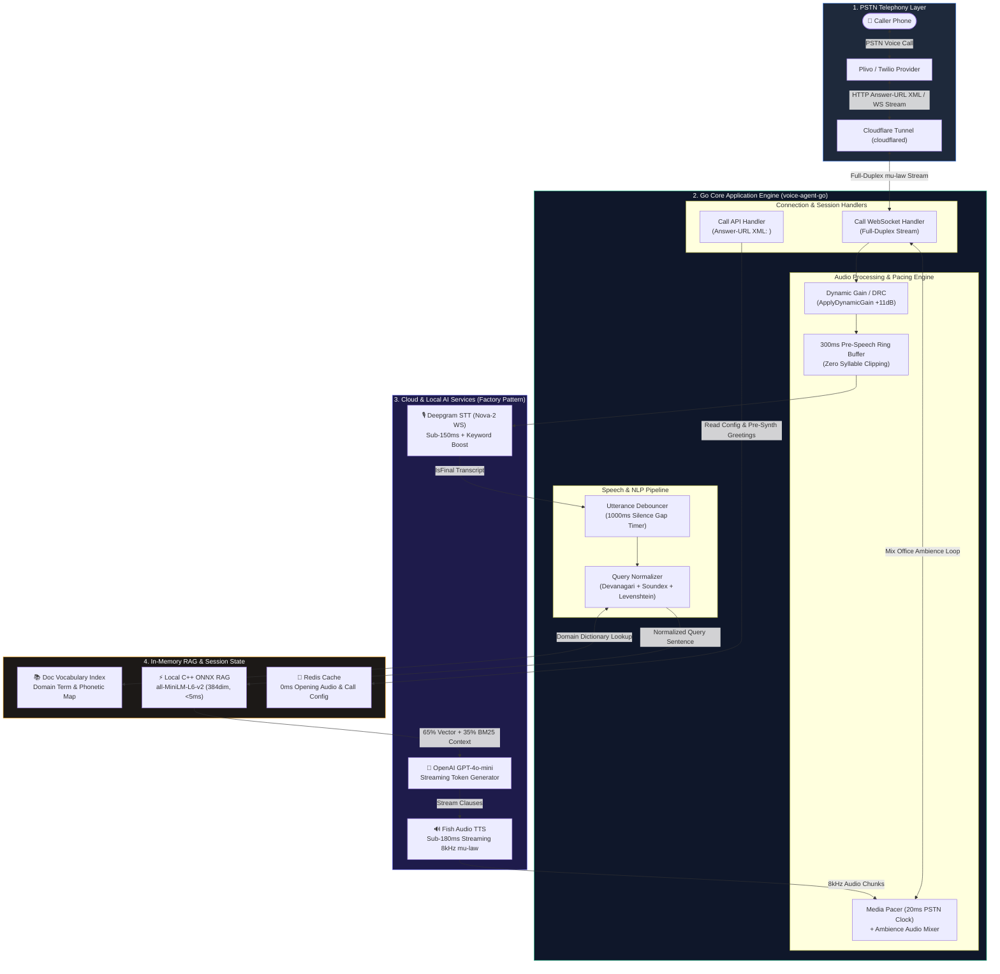

# System Architecture & End-to-End Data Flow: Voice AI Agent

---

## 30-Second Architecture Walkthrough Script (When Screen Sharing)

> *"Here is the complete end-to-end system architecture:*
>
> 1. **Telephony & Media Layer**: When a call comes in over **Plivo**, it hits our **Cloudflare Tunnel** and connects to our Go **`CallWebSocketHandler`** for full-duplex 8kHz audio streaming.
> 2. **Audio Processing**: Incoming audio passes through **Dynamic Range Compression** (to amplify quiet callers) and a **300ms Rolling Ring Buffer** (to prevent initial syllable clipping) before hitting **Deepgram STT** via WebSocket.
> 3. **Normalizer & Hybrid RAG**: When Deepgram emits a final transcript, our **`QueryNormalizer`** fixes Hinglish typos and phonetic errors (*'aco'* $\rightarrow$ *'SEO'*) in <0.5ms using our domain vocabulary index. The query is then sent to our **Local C++ ONNX Hybrid RAG** running in server RAM (<5ms search).
> 4. **LLM & Streaming TTS**: Retrieved context is injected into **GPT-4o-mini**, which streams tokens directly to **Fish Audio TTS**.
> 5. **Pacing & Ambience**: **`MediaPacer`** paces audio chunks at 20ms PSTN frame intervals while continuously mixing background office ambience to ensure the phone line never sounds dead."*
