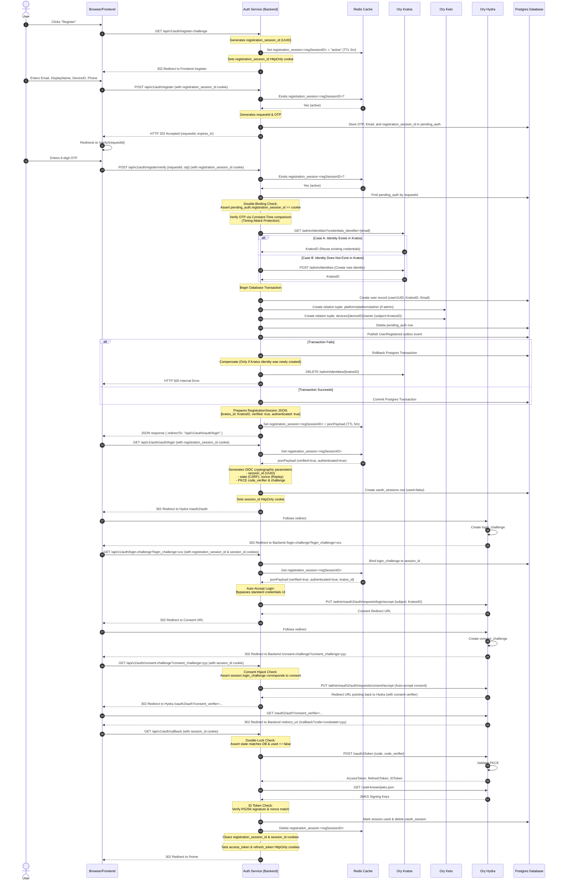

# SafeRide OAuth 2.0 + OTP + SSO Sequence Diagrams

This document contains detailed sequence diagrams mapping out all security checks, cookie validations, and distributed service calls executed during user registration, automatic post-registration login, and standard login.

---

## 1. Registration Flow with Automatic Login (Phases 1–4)

This diagram outlines the registration cookie-binding flow, OTP verification, local database transaction + Ory provisioning with failure compensation, and the automatic transition into the OIDC authorization code flow.

---

## 2. Standard OIDC Login Flow (Session-Bound & Rate-Limited)

This diagram outlines standard login via OTP, detailing session-binding cookie checks, timed rate limiting, session fixation protection, and OIDC token exchange.

```mermaid
sequenceDiagram
    autonumber
    actor User
    participant Browser as Browser/Frontend
    participant Backend as Auth Service (Backend)
    participant DB as Postgres Database
    participant Kratos as Ory Kratos
    participant Hydra as Ory Hydra

    %% Step 1: Login Initiation
    User->>Browser: Clicks "Login"
    Browser->>Backend: GET /api/v1/auth/oauth/login
    Note over Backend: SSO Check:<br/>Checks access_token cookie
    
    alt Token is valid (SSO Fast-Path)
        Backend->>Hydra: POST /admin/oauth2/introspect
        Hydra-->>Backend: { active: true, sub: "KratosID" }
        Backend-->>Browser: 302 Redirect directly to /home
    else Token invalid/absent (Normal Flow)
        Note over Backend: Generates Cryptographic Material:<br/>- session_id (UUID)<br/>- state (CSRF), nonce (Replay)<br/>- PKCE code_verifier & challenge
        Backend->>DB: Store oauth_session details (used=false)
        Note over Backend: Sets session_id HttpOnly cookie
        Backend-->>Browser: 302 Redirect to Hydra /oauth2/auth
    end

    %% Step 2: Login Challenge
    Browser->>Hydra: Redirects to /oauth2/auth
    Hydra->>Hydra: Create login_challenge
    Hydra-->>Browser: 302 Redirect to Backend /login-challenge?login_challenge=xxx
    
    Browser->>Backend: GET /api/v1/auth/login-challenge (with session_id cookie)
    Backend->>Hydra: GET /admin/oauth2/auth/requests/login (Verify challenge validity)
    Hydra-->>Backend: Challenge valid & pending
    Backend->>DB: Bind login_challenge to session in DB
    
    alt Fallback SSO Check (Valid access_token exists)
        Backend->>Hydra: POST /admin/oauth2/introspect
        Hydra-->>Backend: { active: true, sub: "KratosID" }
        Backend->>Hydra: PUT /admin/oauth2/auth/requests/login/accept {subject: KratosID}
        Hydra-->>Backend: Consent Redirect URL
        Backend-->>Browser: 302 Redirect to Consent URL
    else No active session (Normal Flow)
        Note over Backend: Sets login_challenge cookie (non-HttpOnly)
        Backend-->>Browser: 302 Redirect to Frontend /login (clean URL)
    end

    %% Step 3: Frontend Cookie Consumption & Login
    Browser->>Browser: React mounts /login
    Note over Browser: Flash Cookie Pattern:<br/>Reads login_challenge into memory<br/>Deletes login_challenge cookie immediately
    User->>Browser: Enters email
    Browser->>Backend: POST /api/v1/auth/login {email} (with session_id cookie)
    Note over Backend: Rate Limiter protects endpoint
    Backend->>DB: Validate session_id exists & get challenge
    Backend->>Backend: Generate OTP & publish event to Send Email
    Backend-->>Browser: Redirect to /verify/{requestId}

    %% Step 4: OTP Verification & Challenge Acceptance
    User->>Browser: Enters 6-digit OTP
    Browser->>Backend: POST /api/v1/auth/verify {requestId, otp} (with session_id cookie)
    Note over Backend: OTP check using Constant-Time compare<br/>(Timing Attack Protection)
    Backend->>DB: Verify OTP hash, expiry, and failed attempts count
    Backend->>DB: Regenerate session_id (Session Fixation protection)
    Backend->>DB: Lookup KratosID by email
    Backend->>Hydra: PUT /admin/oauth2/auth/requests/login/accept {subject: KratosID}
    Hydra-->>Backend: Returns Consent redirect URL
    Backend-->>Browser: JSON response { redirectTo: ConsentURL }
    Note over Browser: AuthContext Intercepts JSON:<br/>Sets window.location.href = ConsentURL
    Browser->>Hydra: Follows Consent redirect

    %% Step 5: Consent Challenge
    Hydra->>Hydra: Create consent_challenge
    Hydra-->>Browser: 302 Redirect to Backend /consent-challenge?consent_challenge=yyy
    
    Browser->>Backend: GET /api/v1/auth/consent-challenge (with session_id cookie)
    Note over Backend: Consent Hijack Check:<br/>Assert session.login_challenge corresponds to consent
    Backend->>Hydra: PUT /admin/oauth2/auth/requests/consent/accept (Auto-accept consent)
    Hydra-->>Backend: Returns redirect URL pointing back to Hydra (with consent verifier)
    Backend-->>Browser: 302 Redirect to Hydra /oauth2/auth?consent_verifier=...

    %% Step 6: Callback & Token Verification
    Browser->>Hydra: GET /oauth2/auth?consent_verifier=...
    Hydra-->>Browser: 302 Redirect to Backend redirect_uri (/callback?code=xxx&state=yyy)
    
    Browser->>Backend: GET /callback?code=xxx&state=yyy (with session_id cookie)
    Note over Backend: Double-Lock Check:<br/>Matches state and session_id cookie to DB
    Backend->>Hydra: POST /oauth2/token {code, code_verifier}
    Hydra->>Hydra: Verify PKCE (SHA256(verifier) == challenge)
    Hydra-->>Backend: Returns access_token, refresh_token, id_token
    
    Backend->>Hydra: GET /.well-known/jwks.json (Fetch public signing keys)
    Hydra-->>Backend: Return JWKS public keys
    Note over Backend: RS256 Validation:<br/>1. Verifies ID Token signature<br/>2. Verifies nonce matches session.Nonce<br/>(ID Token Forgery & Replay Protection)
    Backend->>DB: Mark session used & delete from DB
    Note over Backend: Validates Final Redirect URL against Whitelist<br/>(Open Redirect Protection)
    Note over Backend: Sets access_token & refresh_token<br/>HttpOnly, Secure, SameSite=Lax cookies
    Backend-->>Browser: 302 Redirect to /home
```

